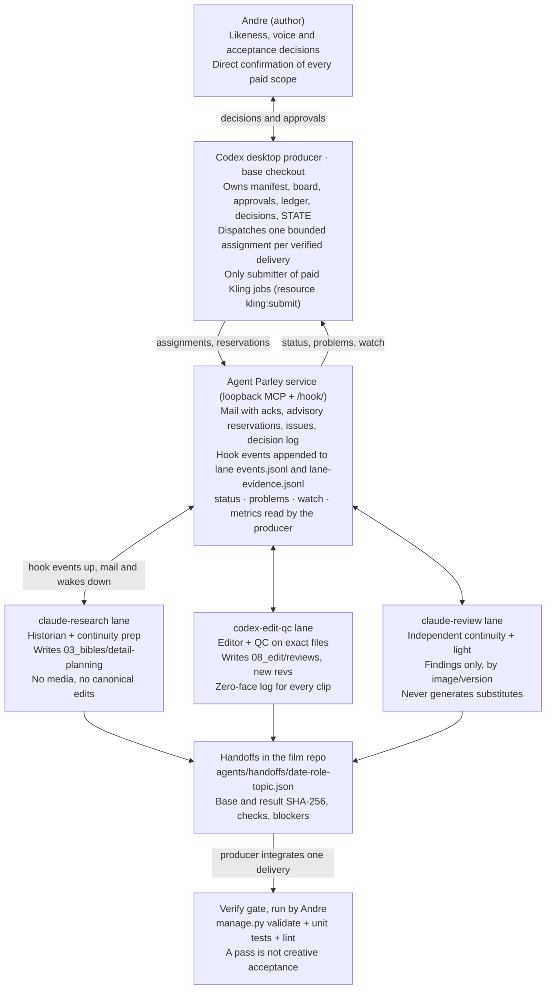

# Movies_Projects × Agent Parley Master Plan

Date: 2026-10-10 · Author: Claude session for Andre Athar · Source doc: https://claude.ai/code/artifact/89aeeadb-5b65-4318-854a-84bb91278f1c

Status: PROPOSED plan. Not an accepted assignment, approval, spending scope or workflow-rule change. The producer integrates it as one delivery per `docs/LOCAL_AGENT_HANDOFF.md`; AGENTS.md links change only if Andre adopts the rules here. Read from the workspace at branch `claude/wizardly-clarke-23j2kj`, head dfec3be.

## Executive summary

The workspace demands one outcome: finish *The Table Between Centuries* (five encounters, 240 s, English master plus a reviewed historical-language master) without breaking any of its identity, face-safety, spending or authority gates, and with every verified delivery chained to an accepted successor. Today 7 of 21 board tasks are complete, 3 are in progress and 11 are blocked; the Galileo chapter exists only as a 42 s guide-voice candidate that has never had full normal-speed playback, and 26 detail-study candidates for all five figures wait for independent review and for Andre's likeness judgment.

The plan below turns the workspace's own rules into an executable program. It keeps the Codex desktop conversation as producer/coordinator (the only role that integrates canonical records and submits paid Kling jobs), and uses Agent Parley to run bounded review, research and QC lanes in separate worktrees, with hooks that publish start, delivery, blocker and failure events into the Parley log so the producer can monitor without polling. Hooks notify; they never approve, spend, commit or merge.

The work runs in six phases, each ending in a successor hook: (0) stand up the Parley lanes and prove round-trip communication with the protocol's read-only smoke test; (1) reconcile the stale canonical state the workspace itself flags (board T13 blocker, manifest/approvals duplication, bible v1 dialogue, session-log gaps); (2) run the independent image continuity review and get Andre's likeness decision on a small selected set; (3) accept the Galileo end-to-end recipe by full playback with audio and timeline/bible reconciliation; (4) transfer that recipe to Caesar, Genghis, Napoleon and Oppenheimer, one chapter at a time, under per-batch written scopes; (5) opening/ending, picture lock, sound, historical-language edition, independent QC of the exact exported masters, and archive. Phases 0 to 2 cost zero credits.

Two things remain Andre-only and cannot be delegated or automated: likeness and voice acceptance, and direct confirmation of any paid scope currently recorded as relayed (D16). Every mistake found along the way is recorded in a Mistake/Solution register (section 7) so the same error is not paid for twice.

## Demand inventory

Every obligation below was read from the workspace on 2026-10-10 (branch `claude/wizardly-clarke-23j2kj`, head dfec3be). Demands fall into four classes: production outcomes (the film), open gates (decisions only Andre can make), state hygiene (what the workspace itself says is stale), and operating rules (how work must be done). Sources are workspace-relative paths.

### A. Production outcomes (board `tasks/board.json`, 21 tasks)

| ID | Demand | Owner role | Status | Blocked by / note |
| --- | --- | --- | --- | --- |
| T01–T05, T08, T09 | Brief, references, bibles, Element, script, pilot, speech route | producer / continuity / historian / dialogue-sound | completed | Scoped completions; T03 does not cover D20 variants, T09 does not close T07 |
| T10 | Reforecast costs, freeze envelope | producer | in progress | Awaits Galileo playback; envelope v3 is an estimate (2,129–2,249) |
| T12 | Approve era and eye keyframes | storyboard | in progress | 12 keyframes + 26 detail studies are candidates; Andre approval after pilot |
| T13 | Galileo as first complete chapter | producer | in progress | Preview v1 42 s decodes, −16.2 LUFS; no full playback, F01 table mismatch, F03 reaction precedes line |
| T06 | Historical-language targets and reviewers | dialogue-sound | blocked | Latin and Corsican absent from ElevenLabs; translations must restart from script v2 |
| T07 | Voice samples and dry dialogue | dialogue-sound | blocked | Andre rejected Kling native voice; D14 guide-only; final voice by ear pending |
| T11 | Storyboard and audio-first animatic | storyboard | blocked | T05, T07, T10 |
| T14–T17 | Caesar, Genghis, Napoleon, Oppenheimer coverage | producer | blocked | T13 recipe acceptance |
| T18 | Opening/ending, English picture lock | editor | blocked | T13–T17 |
| T19 | Correction reserve on measured gaps | producer | blocked | T18 |
| T20 | Historical-language edition | dialogue-sound | blocked | T06, T07, T19 |
| T21 | Deliver and independently verify both masters | qc | blocked | T19, T20 |

The workflow map (`tasks/workflow-map-v1.md`) decomposes these into 68 work packages W01–W68 and a 14-row chapter checklist repeated for each of the five encounters. The plan in section 5 maps every W package to a phase, owner and successor.

### B. Andre-only gates (`memory/STATE.md`, `00_brief/approvals.json`)

| Gate | Demand | Current state |
| --- | --- | --- |
| D16 | Direct confirmation of 23-credit Phase A Galileo over-the-shoulder test | Recorded as relayed via a bot; unsafe to spend as it stands |
| D16-r2 | Fix request.json (5 images sent to a model declaring 2 inputs) and re-confirm | Not fixed; reassess whether new IN/OUT candidates make it unnecessary |
| D17 / D18 / D19 | Table layout, blurred nape, eye-reaction rule | Proposed, not recorded; D17 only after first accepted test shot |
| Likeness | Judge selected new stills (detail studies, IN/OUT frames, posters) | Pending; pilot approval is not inherited |
| Voice | Final Andre voice by ear; dubbing route | Pending; `voiceTests` false |
| Acceptance | Storyboard, paid batch, final picture, final movie | All false; `finalMovieVerified` false |
| Language | Qualified review of Edition H | Pending; no reviewers named |

### C. State hygiene the workspace flags as stale

| Item | Source | Required fix |
| --- | --- | --- |
| T13 blocker text predates back-view direction and D16 | STATE.md | Producer rewrites blocker from current evidence |
| `manifest.json` state string and `manifest.approvals` duplicate `approvals.json` | STATE.md, R06 | One owner, one source; lint rule |
| Scene bibles v1 §3 repeat old dialogue (F05); v2/v3 proposals for four chapters, Oppenheimer has no v3 | STATE.md | Integrate as one revision per bible with hashes |
| `continuity-matrix.csv` stale-stage lines (F06) | STATE.md | Matrix v2 as one revision |
| `session-log.json` mixes timezones, lacks entries for several deliveries | STATE.md | Backfill from handoffs; fixed timezone |
| 80 unresolved credits (lost job ID) and unexplained deltas | R05, ledger | Reconcile or record as unrecoverable |
| 32 handoffs never marked ingested | memory design spec | Handoff v2 `ingest` field and backfill |
| `manage.py status` reports a broken skill source (film-character-continuity) and a changed shared skill (kling-cli) | run on this checkout | Machine-local symlinks; reconnect on Andre's machine, do not copy vendor skills |

### D. Operating rules every lane must honour (`AGENTS.md`, `docs/PARLEY_PROTOCOL.md`, `docs/TOKEN_EFFICIENCY.md`, `docs/REPEATABLE_WORKFLOW.md`)

- Zero full historical faces in any frame, including reflections, silhouettes with facial detail and intermediate frames; eyes-only and below-neck allowed.
- Andre's likeness = 2024 photos + Element 323525046658711 (D01/D11); wardrobe D02; table D04; axis D09; script v2 D07.
- Only the producer submits paid Kling jobs, from the base checkout, after a live balance refresh and a written per-batch scope; no retries, one `--submit-only` then individual `--resume`; never resubmit an existing job.
- Historical balance snapshots (7,741; 6,981; 5,813) are not live. Whole-film authorization is a ceiling, not batch approval. No ElevenLabs purchases.
- Producer owns `manifest.json`, `board.json`, `approvals.json`, ledger, asset registry, decisions, STATE and session-log; lanes return handoffs with base and result hashes.
- One delivery per integration; record base hashes; preserve originals and concurrent work; never clean, reset, move or delete media.
- Every verified delivery ends with an accepted successor, a specific blocker with owner and unblock condition, or an explicit stage end. Until the recipient accepts, the producer still owns the ready task.
- Token economy: one source per subject, consolidated 150–250-word assignments, result in ≤200 words plus file, no polling of unchanged state, no heartbeat for normal activity.
- Commit, merge, push, spending and artistic acceptance are distinct authorizations. Git integration needs its own scope.
- Andre's personal rule: every finished task hooks the next; every mistake becomes a Mistake/Solution record.

## Agent Parley as implemented (v0.18.0, local fork at `/mnt/data/Projects_SSD/agent-parley`)

Agent Parley is a stdlib-only Python 3.12 launcher and coordination service: each agent is a lane with its own Git worktree and branch, a bearer identity, an MCP connection to a loopback service, and native Claude Code or Codex hooks that report lane state. State lives outside the film repo, under `~/.local/state/agent-parley/projects/<hash>/` (or `AGENT_PARLEY_HOME`). It never passes bypass flags; a test asserts their absence. Everything below was read from the fork's code and docs, not from memory.

| Capability | What exists | Command or tool | Limit the plan must respect |
| --- | --- | --- | --- |
| Lanes | Up to 32 participants per project; one terminal per lane; worktree `parley/<project>/lane-N` in the state dir | `agent-parley run NAME --provider claude\|codex --repo PATH [--task T] [--resume]` | Nested launch from a tool call is forbidden; a client the launcher did not start has no wake socket |
| Identity | Bearer token per lane, SHA-256 in SQLite, `operator` reserved for the CLI | MCP connection supplies identity; tool args cannot name another lane | Token is inherited by child processes, so it is not an isolation boundary |
| Mail | Threads, acks with deadline, idempotency keys, search | `send_message` (`ack_required`, `ack_within`), `fetch_inbox`, `wait_for_message`, `acknowledge_message`, `read_thread`, `search_messages` | Idle lane at its prompt receives mail only when a hook fires or a wake lands |
| Reservations | Advisory path and named-resource reservations with optional TTL 30–3600 s; queued requests | `file_reservation_paths`, `request_reservation`, `release_file_reservations`; named resource e.g. `kling:submit` | Advisory only; the `reserved_path` hook denial is the only enforcement, and only inside launched lanes |
| Issues and handoffs | Local issue ledger `issues.json`; claims (max 2 per lane), offers with summary, remaining items and diff, accept by offer ID, orphan takeover recorded | `issue match\|next\|claim\|offer --to NAME --summary --remaining\|accept --offer-id\|decline\|release\|request`; `next_issues` tool | No forge here: issues are local only; PARLEY_PROTOCOL currently says use mail and reports, not issue numbers |
| Reports | Lane state with evidence | `report --state partial\|blocked\|ready\|waiting --summary --evidence --remaining`; `review_report` tool | `ready` means ready for review, not done; a peer verdict is a claim |
| Decisions | Searchable decision log | `search_decisions`; `decision: true` entries per PARLEY_PROTOCOL | Proposals must never be logged as decisions |
| Hooks | `SessionStart`, `UserPromptSubmit`, `PreToolUse`, `PostToolUse`, `PermissionRequest`, `Stop`, `SessionEnd`; required: `SessionStart`, `PreToolUse`, `Stop` | Generated at launch: `{event:[{hooks:[{type:command, command:"bash <home>/hook-client.sh --home H --directory D --participant NAME --protocol N", timeout:3}]}]}` | No `SubagentStop`, `PreCompact` or `Notification` registration; the hook client has a 3 s budget and falls back to in-process checkpoints if the service is down |
| Hook effects | Inject ≤ 1,536 bytes of context on state change; deny only `chained_cli`, `reserved_path`, `offer_expiring`, `filing_overlap` (once), branch switch, branch drift, cwd leaving the worktree; `Stop` blocks once while an issue or work notice is pending | Events appended to `<agent>-events.jsonl`; lane evidence spooled to `lane-evidence.jsonl` | Prompts are never refused; hooks cannot grant trust or answer permission dialogs |
| Monitoring | `status`, `top` (TUI), `problems` (exit 1 when non-empty), `watch NAME --since --kind --json`, `metrics` (Prometheus), `events show\|export`, `history`, `doctor`, `title` | Presence `active\|idle\|stopped\|unknown`; supervision poll 30 s, `inactive_after` 300 s, `stalled_after` 600 s, `claim_idle_after` 3600 s | A stalled claim gets a wake, then an offer to a peer, then release: this must be disabled or lengthened for long human gates |
| Operator steering | Message a lane with optional ack deadline; dialog watcher reads terminals for usage-limit and permission prompts; Telegram/SMTP notify | `agent-parley say NAME TEXT [--ack --within 15m]` | Codex prompts are reported, never answered automatically |
| Integration gate | Pre-merge command per project; merge or PR per lane | `verify set CMD`, `verify show`, `participant merge NAME [--preview]`, `participant pr NAME`, `unattended run` | PARLEY_PROTOCOL: Andre runs the gate; no `participant merge` or `pr` until he asks; `verify set ''` is the only way to remove a gate |
| Lane setup | Per-lane init command and warm pool | `init set CMD`, `pool set N` | Ignored files (`.venv`, credentials) are not in lane worktrees: `init set` must recreate the venv |
| Verification of Parley itself | `make check` = `uv sync --locked`, `ruff check`, `ruff format --check`, `mypy`, `scripts/check_policy.py`, build, `pytest -n auto`; integration tests use the official `mcp` SDK against a temp Git repo | `agent-parley doctor` reads versions, protocol and store schema | Live model behaviour is not covered by tests; Gemini, Copilot, OpenCode and Amp still need live trials |

The fork contains no reference to Movies_Projects, Kling, film or Andre; the film-side binding is only the `coordinate` skill symlink registered in `.agents/plugins/agent-parley/plugin.json` (commit 5fd888f, branch `work/linux-isolation`). The skill itself is sound for this use: status first, `doctor` on unexplained failures, `issue match` before opening, claim before working, reserve before editing, offer to hand off, report then retire.

## Integration architecture

The producer stays where authority already is (the Codex desktop conversation on the base checkout) and Parley supplies three bounded lanes, their worktrees, mail, reservations and hooks. No lane ever touches a canonical record, generates media or spends; every lane result returns as a handoff with hashes, and the producer integrates one delivery at a time before the verify gate runs.



Andre decides at the top; the producer dispatches down through the service; lanes answer upward through hook events and handoffs, never through edits to canonical files.

### Lane roster

| Lane name | Provider | Film roles it may hold | Allowed write paths (reserve first) | Must never |
| --- | --- | --- | --- | --- |
| `claude-research` | claude | historian, continuity preparation, dialogue-sound text work | `03_bibles/detail-planning/`, `03_bibles/scene-bibles/*-vNEXT.md`, `01_script/translations/` proposals, `00_brief/research/`, own handoff | Generate media, edit canonical records, log proposals as decisions |
| `codex-edit-qc` | codex | editor, QC, storyboard coverage review | `08_edit/reviews/`, `08_edit/timelines/*-vNEXT.json`, `08_edit/normalized/`, `09_delivery/qc/`, own handoff | Re-render by default, modify another lane's documents, accept takes |
| `claude-review` | claude (second account if needed, `--credentials`) | independent continuity, lighting, facial-safety reviewer | `02_references/_review/`, `08_edit/reviews/<topic>-independent/`, own handoff | Generate substitutes, touch files reserved by `codex-edit-qc` |
| producer (not a lane) | Codex desktop, base checkout | producer, director, image creator | manifest, board, approvals, ledger, registry, decisions, STATE, session-log, `07_generations/`, `05_storyboard/keyframes/` | Dispatch dependent work before delivery evidence exists; spend on a relayed approval |

The `operator` identity (CLI only) is Andre at his terminal: `agent-parley say`, `participant merge`, `verify set`. Lighting and dialogue-sound get their own lane only when a bounded task exists for them; otherwise `claude-review` carries lighting and `claude-research` carries dialogue text work, as the workflow map allows.

### Worktree and state layout

- Film repo: `/mnt/data/Projects_SSD/Movies_Projects`, branch `main`, LFS. Lanes get `parley/<project>/lane-N` worktrees under `AGENT_PARLEY_HOME`; `init set '.venv/bin/python -m venv .venv'` is not enough because the venv is ignored, so the init command recreates it: `python3 -m venv .venv && .venv/bin/python -m pip -q install -e . 2>/dev/null || true` (the management tools are stdlib, so a bare venv suffices).
- Parley state: `~/.local/state/agent-parley/projects/<hash>/` holds the SQLite store, `issues.json`, `<lane>-events.jsonl`, `lane-evidence.jsonl`. Nothing from it is copied into the film repo except the handoffs lanes write themselves.
- Reservations: the producer reserves the canonical set once per session with no TTL; lanes reserve their output folders per assignment with a TTL of 3600 s and release at handoff. The named resource `kling:submit` is held by the producer only.

### Dispatch contract (one message per assignment, 150–250 words)

`send_message` with `ack_required` and `ack_within` 900 s, idempotency key `<task>-<version>-<n>`, body: goal, film role, parent board task and W package, input paths with SHA-256, allowed output paths, definition of done with required evidence files, constraints (no media, no spending, no canonical edits), next owner on completion. An unacknowledged deadline returns the task to the producer with the recipients' reasons; the producer then records a blocker with owner or re-offers to a fit lane. A delivery is accepted only when its handoff's result hashes match the files on disk in the lane worktree and the checks it names were run.

### Why not the Parley merge path yet

`participant merge` and `participant pr` stay unused until Andre asks (PARLEY_PROTOCOL). Until then the producer copies lane deliveries by explicit path into the base checkout, verifies hashes, and records the integration in a handoff. When Andre authorises it, `verify set ".venv/bin/python scripts/manage.py validate && .venv/bin/python -m unittest discover -s tests"` makes the gate automatic and `participant merge NAME --preview` shows the diff before any merge.

## Phased execution plan

Six phases, each closed by a gate and a successor hook. Phases 0–2 cost zero Kling credits. Every task names its owner, the lane that executes it, the inputs by path, the evidence that proves it done, and the hook that starts the next task. W numbers are the workflow-map packages; T numbers are board tasks. Order inside a phase is the dispatch order; tasks marked ∥ run in parallel in different lanes.

```mermaid
flowchart TB
    P0["Phase 0 · Parley stand-up (0 credits)<br/>Three lanes, round-trip smoke test, hook proof, supervision tuned"]
    G0{"Gate 0 · 3 acks, 3 hook event kinds, 1 reserved-path denial observed"}
    P1["Phase 1 · Reconcile canonical state (0 credits)<br/>Blockers rewritten, lint and handoff v2, 32 handoffs ingested, ledger and D16 resolved"]
    G1{"Gate 1 · validate, lint and tests pass; D16 confirmed or superseded"}
    P2["Phase 2 · Image review and likeness (0 credits)<br/>Three independent reviews, corrections, Andre judges up to 8 frames, bibles reconciled"]
    G2{"Gate 2 · one approved still per encounter; zero-face log clean"}
    P3["Phase 3 · Galileo recipe (cap 900 · spent 348)<br/>Full playback, animatic, optional proof shot, QC, chapter accepted, envelope v4"]
    G3{"Gate 3 · T13 accepted by producer and Andre; envelope v4 recorded"}
    P4["Phase 4 · Four chapters (cap 3,300)<br/>Chapter loop, one in paid production at a time; next chapter prepared in lanes meanwhile"]
    G4{"Gate 4 · T14 to T17 accepted; ledger within caps"}
    P5["Phase 5 · Cut, sound, Edition H, QC (cap 1,300 + reserve 431)<br/>Picture lock, final voice, languages, masters, independent QC, archive"]
    G5{"Gate 5 · both masters verified on the exact exported files and accepted by Andre"}
    P0 --> G0 --> P1 --> G1 --> P2 --> G2 --> P3 --> G3 --> P4 --> G4 --> P5 --> G5
```



Phases are not dated: measured speech, generator waits and Andre's review time set the pace, and the workspace forbids presenting a speculative schedule as guaranteed. Caps are the manifest's phase caps; they are ceilings, not approvals.

### Phase 0 — Stand up Parley and prove the round trip (0 credits)

Owner: Andre as `operator` at the terminal, producer for film-side records. Nothing in this phase touches film content.

| ID | Task | Executor | Inputs | Evidence of done | Successor hook |
| --- | --- | --- | --- | --- | --- |
| P0.1 | Run `agent-parley doctor` and `agent-parley doctor --json`; run `make check` in the fork only if the fork changed since 5fd888f | Andre (operator) | fork at `work/linux-isolation` | `reports/parley-setup-v1/doctor.json`; version, protocol and store schema consistent | P0.2 |
| P0.2 | `agent-parley up`; register the film repo; `init set 'python3 -m venv .venv'`; `pool set 0` | Andre (operator) | film repo on `main` | `agent-parley status` shows the project; init command recorded | P0.3 |
| P0.3 | Launch three lanes in three terminals: `run claude-research --provider claude --repo <film>`, `run codex-edit-qc --provider codex --repo <film>`, `run claude-review --provider claude --repo <film>` (add `--credentials account-2` if the two Claude lanes must not share a login); resume lane approvals; no `--auto-mode` | Andre (operator) | P0.2 | `participant list` shows three `active` lanes with worktrees; no bypass flag in any launch line | P0.4 |
| P0.4 | Producer reserves the canonical set (manifest, board, approvals, ledger, registry, decisions, STATE, session-log) with no TTL and the named resource `kling:submit` | producer | P0.3 | Reservation IDs recorded in `reports/parley-setup-v1/reservations.json` | P0.5 |
| P0.5 | Run the PARLEY_PROTOCOL smoke test: four questions to `codex-edit-qc`, `ack_required`, 900 s | producer | AGENTS.md, STATE.md | Thread ID; four answers match the pass criteria; any miss fixes STATE/AGENTS and lands in `mistakes.jsonl` | P0.6 |
| P0.6 | Prove hooks: `watch claude-research --json` while the lane reads one file and stops; confirm `SessionStart`, `PreToolUse`, `Stop` rows in `<lane>-events.jsonl`; from a lane, attempt one write to a producer-reserved path (a scratch copy, no real file) and confirm the `reserved_path` denial | producer + Andre | P0.4 | `reports/parley-setup-v1/hook-proof.md` with the three event rows and the denial text | P0.7 |
| P0.7 | Lengthen supervision for human gates: `stalled_after` and `claim_idle_after` to one working day in the project settings, so Andre's review time does not trigger wake, offer and release | Andre (operator) | operations.md §supervision | Settings shown by `agent-parley status --json` | P0.8 |
| P0.8 | Write `docs/PARLEY_PROTOCOL.md` v2: lane roster, dispatch contract, hook proof, supervision values; link from AGENTS.md (rule change = AGENTS link update) | producer | P0.1–P0.7 | Diff reviewed; `manage.py validate` ok | **Phase 1**: producer accepts P1.1 itself and dispatches P1.3 |

Gate 0: three lanes acknowledged a message, three hook event kinds were observed, one reserved-path denial was observed. Without all three, no film task is dispatched through Parley and the manual handoff process remains the mechanism.

### Phase 1 — Reconcile canonical state and build the close-out tooling (0 credits)

Owner: producer. Memory design spec Phases 1–4 become real here, as approved in chat for design only; implementation is this phase's bounded scope.

| ID | Task | Executor | Inputs | Evidence of done | Successor hook |
| --- | --- | --- | --- | --- | --- |
| P1.1 | Rewrite T13, T12 and T10 blocker text from current evidence (back-view direction, D16 state, preview v1 findings F01/F03) — W03 | producer | STATE.md, handoffs 2026-10-09/10 | `board.json` diff; `validate` ok | P1.2 |
| P1.2 ∥ | Extend `scripts/manage.py` with `resume`, `handoff check`, `handoff ingest`, `lint` (stdlib, Google style, tests in `tests/test_manage.py`) — memory spec Phase 2 | `codex-edit-qc` as tooling role | memory-handoff design spec | New tests pass; `lint` reports the known duplications; no change to canonical data by the tool | P1.4 |
| P1.3 ∥ | Handoff template v2 (`readFirst`, `claims[]`, `nextActions[]`, `blockers[]`, `andreOnlyGates[]`, `proposedDecisions[]`, `contributorKind`, `ingest`, `mistakes[]`) and role briefs with reads/writes/may-not/done — memory spec Phase 1 | `claude-research` as documentation role | `shared/templates/agent-handoff.json`, `agents/*.md` | Template validates with `handoff check`; nine briefs updated | P1.4 |
| P1.4 | Ingest the 32 existing handoffs with `handoff ingest`; backfill `session-log.json` in one timezone | producer | P1.2, P1.3 | Every handoff carries `ingest.ingested`; `lint` clean on ingestion | P1.5 |
| P1.5 ∥ | One revision per scene bible integrating v2/v3 proposals; author Oppenheimer v3; continuity matrix v2; stale-stage lines removed (F05, F06) — W12 | `claude-research` as continuity role | bibles v1–v3, matrix v1, D20, direction doc | New files only, hashes in handoff; `claude-review` reads and confirms no dialogue regression | P1.6 |
| P1.6 | Resolve manifest/approvals duplication: `manifest.approvals` becomes a pointer; `lint` fails on divergence (R06) | producer | P1.2 | `validate` and `lint` pass | P1.7 |
| P1.7 | Reconcile the ledger: query the Kling task list by CLI for the lost 80-credit job; record found or `unrecoverable`; explain the 2×41 anomalies or mark them open (R05) | producer | `credit-ledger.csv`, CLI read-only queries | Ledger rows with disposition; balance refreshed and recorded with timestamp | P1.8 |
| P1.8 | D16 to Andre directly: confirm, decline or supersede; D16-r2 judged against the IN/OUT and detail-study candidates (R07, R08) | Andre, prepared by producer | D16 record, candidates gallery | Decision record updated with `grantedBy: Andre direct` and quote, or marked superseded | P1.9 |
| P1.9 | D17–D19 stay proposals; record only when their condition holds (D17 after first accepted test shot) | director | STATE.md §gates | Decision files exist only for recorded decisions | P1.10 |
| P1.10 | Skill registry: reconcile the four hash warnings by reading the source diffs; reconnect the broken `film-character-continuity` link on Andre's machine; no vendor copy | producer | `skills/registry.json`, `status` output | `manage.py status` returns `ok` with zero errors | P1.11 |
| P1.11 | Create `memory/mistakes.jsonl` with the eight seed entries from section 7 | producer | section 7 | File exists; `lint` reads it | **Phase 2**: producer dispatches P2.1 and P2.2 |

Gate 1: `validate` ok, `lint` without hard contradictions, unit tests pass including the new ones, 32 handoffs ingested, D16 resolved either way. A passing gate is workspace validity, not film acceptance.

### Phase 2 — Independent image review and Andre's likeness gate (0 credits)

Owner: producer. Executes the workflow map's immediate queue items 1, 2 and 4.

| ID | Task | Executor | Inputs | Evidence of done | Successor hook |
| --- | --- | --- | --- | --- | --- |
| P2.1 ∥ | Historical material, costume and uncertainty review of the 26 candidates — W14 | `claude-research` as historian | catalog `detail-studies-v1/manifest.json`, research v2, D20 | `08_edit/reviews/detail-studies-v1-materials/findings.md`, one row per image and version | P2.4 |
| P2.2 ∥ | Likeness evidence, proportions, grooming; table, chairs, eye line, axis; hands, feet, rear-head facial safety — W15, W16, W17 | `codex-edit-qc` as continuity/QC | catalog, approved photos, D02, D04, D09 | `.../detail-studies-v1-continuity/findings.md` + `zero-face-log.json` | P2.4 |
| P2.3 ∥ | Motivated light source, direction, shadows, era plausibility — W18 | `claude-review` as lighting | catalog, research v2 §light | `.../detail-studies-v1-lighting/findings.md` | P2.4 |
| P2.4 | Consolidate findings; choose principal angle (left shoulder under D09) and minimal inserts; corrections list by image — W21 | producer | P2.1–P2.3 | `review.md` v2 with disposition per image; selection ≤ 2 images per encounter | P2.5 |
| P2.5 | Correct only affected images with the built-in image route (0 Kling credits); new versions beside originals — W19 | producer as image creator | P2.4 | Catalog rows with new hashes; superseded variants preserved | P2.6 |
| P2.6 | Re-review only changed outputs | `claude-review` | P2.5 | Findings addendum | P2.7 |
| P2.7 | Andre judges likeness on the selected set (≤ 8 frames) — W20 | Andre, arranged by producer | P2.4–P2.6 | One `review-decision.json` per frame with `andre_approved` or rejected | P2.8 |
| P2.8 | Reconcile bibles with selected shots; lock grooming, posture, wardrobe, table anchors for animation — W06 | `claude-research` as continuity | P2.7, P1.5 bibles | Bible revision citing decision IDs; STATUS line updated | **Phase 3**: producer dispatches P3.1 |

Gate 2: at least one approved still per encounter for the principal angle, zero-face log clean, bibles cite decisions. Rejections return to P2.5 for that image only.

### Phase 3 — Accept the Galileo end-to-end recipe (Galileo cap 900, spent 348, stop at 810)

Owner: producer. This is T13. The existing v2 candidate is reviewed before anything new is generated.

| ID | Task | Executor | Inputs | Evidence of done | Successor hook |
| --- | --- | --- | --- | --- | --- |
| P3.1 | Locate the exact Galileo v2 timeline and preview from the codex lane handoff; full normal-speed playback with audio; dispositions for F01 and F03 — W43, W44 | `codex-edit-qc` as editor/QC | lane handoff, `08_edit/picture-lock/`, bibles from P2.8 | `08_edit/reviews/galileo-en-v2/playback-report.md` with timestamps, loudness, defects | P3.2 |
| P3.2 ∥ | Measure guide dialogue and pauses; audio-led Galileo animatic; resolve the two-second eye choice locally — W23, W24 | `codex-edit-qc` + `claude-research` (dialogue text) | script v2, existing guide tracks | `measured_seconds` filled in `dialogue-lines.csv` revision; animatic file | P3.3 |
| P3.3 | Decide whether an over-the-shoulder proof shot is needed; if yes: reference packet with roles (W35), safe motion and face exclusions (W36), schema preflight (W37), scope record with ceiling and live balance | producer + director | P2.7 stills, P3.1 defects | `07_generations/requests/galileo-ots-v1/request.json` + `scope.json`; preflight hook passes | P3.4 or skip to P3.5 |
| P3.4 | Submit once with `kling_batch.py --submit-only`, then `--resume`; persist job ID and charge immediately — W38, W39 | producer only, base checkout | P3.3 | Ledger row, response file, original preserved | P3.5 |
| P3.5 ∥ | Full-clip QC: every frame for faces, identity, anatomy, contact; sync and reaction timing — W40, W41 | `codex-edit-qc` + `claude-review` | P3.4 output | `zero-face-log.json`, `take-review.json` per take | P3.6 |
| P3.6 | Register take disposition; reconcile charges — W42 | producer | P3.5 | Board T13 note, ledger reconciled | P3.7 |
| P3.7 | Assemble the chapter with foley cues; full playback with audio; producer acceptance; Andre's likeness in motion — W45, W50, W51 | `codex-edit-qc` editor, dialogue-sound for cues, Andre | P3.1–P3.6 | `galileo-en-v3` preview + review; Andre decision record | P3.8 |
| P3.8 | Freeze the envelope from measured charges: accepted seconds, chapter caps, reserve — W33, T10 | producer | ledger, P3.7 | `docs/budget-and-envelope-resume-v4.md`; T10 completed | **Phase 4**: producer dispatches chapter prep for the next encounter |

Gate 3: Galileo accepted end to end by producer and Andre; T13 completed; envelope v4 recorded. Until then T14–T17 stay blocked, but their zero-credit preparation (P4.1–P4.3) may run in lanes.

### Phase 4 — Four more chapters, one in paid production at a time (main footage cap 3,300)

Owner: producer. The chapter loop below runs for Caesar, Genghis, Napoleon and Oppenheimer (T14–T17); the producer picks the order from Phase 2 findings. Zero-credit preparation for chapter N+1 runs in lanes while chapter N is in paid production.

| Step | Task | Executor | Evidence of done | Successor hook |
| --- | --- | --- | --- | --- |
| P4.1 | Difficult line, trigger word, prior emotion, reaction and consequence sheet — W09 | director + `claude-research` | Encounter sheet per direction doc, line IDs from script v2 | P4.2 |
| P4.2 | Coverage selection mapped to slot IDs; animatic revision — W21, W34 | `codex-edit-qc` | Shot list rows for the chapter; animatic | P4.3 |
| P4.3 | Reference packet, safe motion plan, preflight, scope record with per-chapter ceiling — W35, W36, W37 | producer + director | Request and scope files; preflight hook pass; live balance | P4.4 |
| P4.4 | Submit once; resume; persist — W38, W39 | producer only | Ledger rows, originals | P4.5 |
| P4.5 | Full-clip QC and sync review — W40, W41 | `codex-edit-qc` + `claude-review` | Zero-face log and take reviews | P4.6 |
| P4.6 | Take disposition and charge reconciliation — W42 | producer | Board note, ledger | P4.7 |
| P4.7 | Chapter assembly, foley contacts, full playback, acceptance — W45, W50, W51 | editor, dialogue-sound, Andre | Chapter preview vN + review + decision | Next chapter P4.1, or **Phase 5** after the fourth chapter |

Gate 4: four chapters accepted; T14–T17 completed; ledger within caps. A chapter that fails QC returns to P4.3 with a measured defect and a new hypothesis, never an automatic retry.

### Phase 5 — Cut, sound, historical-language edition, QC and archive (corrections cap 1,300, reserve 431)

| ID | Task | Executor | Evidence of done | Successor hook |
| --- | --- | --- | --- | --- |
| P5.1 | Opening and ending under the approved script; normalize sources; table transitions; English rough cut — W47, W48 | director + producer, `codex-edit-qc` | `08_edit/timelines/film-en-v1.json`; rough cut file | P5.2 |
| P5.2 | Rough-cut review for story, pacing, continuity; prioritized gap list — W49 | `claude-review` + director | Gap list by severity | P5.3 |
| P5.3 | Correction reserve on measured gaps only; reinspect replacements — W52, W53, T19 | producer + QC | Correction requests, ledger | P5.4 |
| P5.4 | Final dialogue conform, colour, shot-to-shot light; picture lock — W54, T18 | editor + lighting | `08_edit/picture-lock/film-en-lock-v1` | P5.5 and P5.6 ∥ |
| P5.5 | Final Andre voice by ear; dubbing route; measured durations; sync revision where needed — W25, W27, T07 | dialogue-sound + Andre | Voice decision record; `voiceTests` true only after Andre listens | P5.7 |
| P5.6 | Historical-language targets and qualified reviewers named; translate from script v2, back-translate, pronunciation review — W28, W29, T06 | dialogue-sound + reviewers Andre names | T06 unblocked with named reviewers; translations revision | P5.8 |
| P5.7 | Mix, loudness and true peak measured — W55 | dialogue-sound | Measurement file beside the mix | P5.9 |
| P5.8 | Edition H assembly with speech variants; captions for both editions against actual audio — W56, W57, T20 | dialogue-sound + editor | Edition H timeline; caption files | P5.9 |
| P5.9 | Export exact masters and stems; independent QC decodes and plays both files fully; zero-face log over the masters — W58, W59 | editor, then independent QC in `claude-review` | `09_delivery/qc/` evidence report | P5.10 |
| P5.10 | Andre's final likeness, performance, voice and story acceptance — W60, T21 | Andre | `finalPicture`, `finalMovieVerified` true with artifact hashes | P5.11 |
| P5.11 | Package masters, captions, stems, sources, rights notes, ledger; archive; continuation template check — W61, W62 | producer | Delivery folder, inventory snapshot, STATE closing entry | Stage complete: no successor; continuation only on Andre's request |

Gate 5: both masters verified on the exact exported files by an independent reviewer and accepted by Andre. Commit and push of the delivery are separate authorizations.

## Hook and monitoring specification

Two layers of hooks exist and must not be confused. Parley's own lane hooks are generated at launch and are not edited; they report lane state and enforce only the seven denials listed in section 3. The film adds a second, project-level layer under `.claude/hooks/` in the film repo, versioned with the project, that encodes the workspace's gates. Both layers notify and refuse; neither approves, spends, commits or wakes the desktop conversation. Phase 0 proves the first layer; the second layer is built in Phase 1 (P1.2 scope) and switched on only after the dry-run tests below pass, as the cleanup plan Phase 6 requires.

### Layer 1 — Parley lane hooks (exist today, proven in P0.6)

| Event | What Parley does with it | What the producer reads |
| --- | --- | --- |
| `SessionStart` | Injects ≤ 1,536 bytes of coordination context; records presence | `status`: lane `active` |
| `UserPromptSubmit` | Delivers pending mail into the lane; never refuses | `watch NAME --kind mail` |
| `PreToolUse` | Denies `chained_cli`, `reserved_path`, branch switch or drift, cwd outside worktree, `offer_expiring`; otherwise records | `problems` lists denials; `events show` |
| `PostToolUse` | Records lane evidence to `lane-evidence.jsonl` | `history participant NAME` |
| `PermissionRequest` | Reports the dialog; never answers it | dialog watcher in `top`; Telegram notify if configured |
| `Stop` | Blocks once while an issue or work notice is pending, so a lane cannot end with an unacknowledged assignment | `status --pending` |
| `SessionEnd` | Marks the lane `stopped`; claims become orphan candidates after `orphan_retire_after` | `status --idle`, `issue claim --take-orphaned` only by the producer |

### Layer 2 — Film gate hooks (to build in P1.2, enable after dry run)

All scripts are stdlib Python, exit 2 to deny with a one-line reason, exit 0 to allow, and append one JSON line to `projects/andre-time-travel/logs/hooks.jsonl` with `{ts, lane, event, tool, path, decision, reason}`. They run from the film's `.claude/settings.json` in every lane worktree because the file is versioned. The producer's desktop conversation is not a Claude Code session; it runs the same checks by calling the scripts directly before each action (`python3 .claude/hooks/<name>.py --check ...`).

| Hook file | Event and matcher | Verifies | Denies when | Logs |
| --- | --- | --- | --- | --- |
| `canonical-guard.py` | `PreToolUse` on `Write`, `Edit`, `MultiEdit`, `NotebookEdit` | Target path against the producer-owned list (manifest, board, approvals, ledger, registry, decisions, STATE, session-log) and against reserved paths of other lanes read from `agent-parley status --json` | Lane is not the producer, or path is reserved by another lane | decision + path |
| `media-guard.py` | `PreToolUse` on `Bash` | Command text for `rm`, `mv`, `git clean`, `git reset --hard`, `git checkout --` touching `02_references`, `05_storyboard`, `06_pilot`, `07_generations`, `08_edit`, `09_delivery`, `inbox` | Any match | command (redacted of tokens) |
| `kling-preflight.py` | `PreToolUse` on `Bash` matching `kling_batch.py --submit-only` or any `kling` CLI generation verb | A `scope.json` beside the request with `ceiling`, `grantedBy`, `balanceBefore`, `balanceTimestamp` (< 15 min old), `requestSha256`; request inputs count within the model's declared schema; lane holds `kling:submit` | Any field missing, balance stale, schema mismatch, lane is not the producer, `grantedBy` contains "relayed" | scope path + result |
| `no-retry.py` | `PreToolUse` on `Bash` matching `--resume` or `--submit-only` | Job ID not already present in `credit-ledger.csv` with a terminal status | Duplicate submission of a recorded job | job ID |
| `handoff-check.py` | `Stop` | Lane wrote at least one new file under `agents/handoffs/` this session whose `changedFiles[].sha256After` match disk, `verification[]` is non-empty, and `nextActions[]` names a role | Lane has edits but no valid handoff; exit 2 with the missing field, which blocks the stop once | handoff path + missing fields |
| `zero-face-gate.py` | `Stop` for lanes whose assignment role is `qc` or `continuity` | A `zero-face-log.json` exists beside every clip or image set the handoff claims reviewed, listing frames inspected and reflections checked | Log missing for a claimed review | paths |
| `mistake-capture.py` | `PostToolUse` on `Bash` when exit code ≠ 0, and on any Layer 2 denial | Appends a draft entry to the lane's handoff `mistakes[]` with command, error line and timestamp; the producer promotes it to `mistakes.jsonl` at ingest | Never denies | draft entry |
| `successor-check.py` | `Stop` | Handoff `nextActions[]` is non-empty or `stageComplete: true` with reason | Delivery with no successor and no explicit stage end | handoff path |

Settings shape in the film repo (Layer 2 only; Layer 1 is passed by the launcher as `--settings` and merges with it):

```json
{"hooks": {
  "PreToolUse": [
    {"matcher": "Write|Edit|MultiEdit|NotebookEdit", "hooks": [{"type": "command", "command": "python3 .claude/hooks/canonical-guard.py", "timeout": 5}]},
    {"matcher": "Bash", "hooks": [
      {"type": "command", "command": "python3 .claude/hooks/media-guard.py", "timeout": 5},
      {"type": "command", "command": "python3 .claude/hooks/kling-preflight.py", "timeout": 10},
      {"type": "command", "command": "python3 .claude/hooks/no-retry.py", "timeout": 5}]}],
  "PostToolUse": [{"matcher": "Bash", "hooks": [{"type": "command", "command": "python3 .claude/hooks/mistake-capture.py", "timeout": 5}]}],
  "Stop": [{"hooks": [
      {"type": "command", "command": "python3 .claude/hooks/handoff-check.py", "timeout": 10},
      {"type": "command", "command": "python3 .claude/hooks/zero-face-gate.py", "timeout": 10},
      {"type": "command", "command": "python3 .claude/hooks/successor-check.py", "timeout": 5}]}]
}}
```

For the Codex lane the same scripts are passed as `-c hooks.<Event>=[...]` by the launcher's Codex adapter, which already supports the full event set; the film does not add Codex-specific scripts.

### Dry-run tests before enabling Layer 2 (cleanup plan Phase 6 safeguards)

All run against dummy artifacts under `drafts/hook-rehearsal/`, no media, no credits, no external writes. Each is a stdlib unit test in `tests/test_hooks.py`.

1. Duplicate completion: two identical handoffs produce one successor assignment and zero generation requests.
2. Missing output or changed hash: `handoff-check.py` denies; the dependent task is not dispatched.
3. Recipient unavailable: `send_message` with `ack_required` returns the recipient's reason; producer record shows the task still owned by the producer with a blocker.
4. Restart: kill the service mid-assignment; `agent-parley up`; state resumes from SQLite with no lost handoff and no duplicate claim.
5. Input revision change: a bible revision invalidates only reviews that cite its old hash (`lint` reports them).
6. No successor: a handoff with `stageComplete: true` passes `successor-check.py`.
7. Paid gate: `kling-preflight.py` denies on each missing field, on a stale balance, on a relayed grant, and on a lane without `kling:submit`.
8. Media guard: every destructive pattern is denied; a plain `ls` passes.

### Monitoring routine (event-driven, per TOKEN_EFFICIENCY §5)

- The producer runs `agent-parley problems` when a delivery arrives, before dispatching, and at session start; a non-zero exit is the only reason to open `status --json`.
- `watch NAME --since <last check>` replaces re-reading threads; `wait_for_message` replaces inbox polling inside lanes.
- `metrics --output reports/parley/metrics.prom --every 30` only if Andre wants the local PC load tracked alongside Parley presence; the file stays out of Git.
- Andre at his terminal: `agent-parley top` for a live view; `agent-parley say NAME TEXT --ack --within 15m` to steer; `agent-parley title` in the status line.
- No heartbeat Routine, no cron, no automatic dispatcher. A wake from supervision is a notification; the producer still decides and dispatches.

### Local PC performance note

Three lanes, the service and the desktop conversation share Andre's machine with local LLM training. Parley's service is a single Python process with a 30 s poll; the lanes are the CLIs themselves. Keep `pool set 0` so no spare worktrees sit on the SSD, run `pool`/`init` only in Phase 0, and schedule paid Kling QC (which decodes 1672×941 PNG sets and MP4s) outside training windows. The film's own tools are stdlib and offline; the renderer (Pillow, ReportLab, Poppler) is the only heavy local dependency and runs only when an atlas revision is rebuilt.

## Risks, gates and the Mistake/Solution record

The ten risks in `memory/risks.json` stay the risk register; this plan adds an owner, the phase that retires each one, and the hook that watches it. Nothing here changes a gate: likeness, voice, paid scope, commit, merge, push and final acceptance remain separate authorizations held by the people named in AGENTS.md.

| Risk | Owner | Retired in | Hook that watches it |
| --- | --- | --- | --- |
| R01 Likeness on new material | Andre, arranged by producer | Phase 2 (selected stills), Phase 4 per chapter | `deliver` event carries `likenessStatus`; dispatcher refuses video packets whose stills are not `andre_approved` |
| R02 Historical face exposure | QC lane | Every paid output, Phase 3–5 | Stop hook on QC lane requires `zero-face-log.json` beside each reviewed clip |
| R03 Historical languages | dialogue-sound | Phase 5 | Blocker event with owner until reviewers named; no Edition H dispatch without `languageReviewer` |
| R04 External audio sync | dialogue-sound + editor | Phase 3 (English), Phase 5 (Edition H) | Deliver event must cite measured durations file |
| R05 Cost forecast and 80 lost credits | producer | Phase 1 reconcile, Phase 3 refresh | PreToolUse hook on `kling_batch.py --submit-only` refuses without a fresh balance file (< 15 min) and a scope record |
| R06 State duplication | producer | Phase 1 | `manage.py lint` run in the verify gate |
| R07 Relayed approval (D16) | Andre | Phase 1 | Decision records with `grantedBy` containing "relayed" are flagged `andreOnly: unconfirmed` |
| R08 Request/schema mismatch | producer | Phase 1 | Preflight hook validates request.json against the live schema before submit |
| R09 Table geometry and reaction timing | editor + producer | Phase 3 | Galileo acceptance requires F01 and F03 dispositions in the review file |
| R10 Concurrent edits, uncommitted work | producer | Phase 0 (reservations), ongoing | Parley reservations on producer-owned files; PostToolUse hook refuses writes to another lane's reserved path |

### Mistake/Solution record (Andre's rule: every mistake becomes knowledge)

One file, append-only, producer-owned: `projects/andre-time-travel/memory/mistakes.jsonl`. One line per entry, written at the moment the mistake is confirmed, never rewritten. Fields:

```json
{"id":"M-2026-10-10-01","date":"2026-10-10","phase":"1","task":"W03","lane":"producer",
 "mistake":"Phase A request.json passed 5 images to gemini-3-pro-image which declares image_1/image_2 only",
 "detected_by":"schema preflight","cost":"0 credits (caught before submit)",
 "root_cause":"request built from a plan, not from the live schema",
 "solution":"request-r2 with 2 inputs; preflight hook validates every request against who_am_i schema",
 "rule_added":"hooks/kling-preflight.sh","risk":"R08","evidence":"logs/kling-discovery-checkpoint/"}
```

Procedure:

1. Any lane that finds a mistake (its own or another's) writes the entry in its handoff under `mistakes[]`; the producer copies it to `mistakes.jsonl` at ingest and assigns the ID.
2. Every entry must name a `solution` and, where the solution is repeatable, a `rule_added`: a hook, a lint check, a checklist row, or a line in the relevant doc. A mistake without a rule is still open.
3. `manage.py lint` (Phase 1 tooling) reports entries older than seven days with no `rule_added`.
4. The producer reads the file at session start, after STATE.md. It is history, so it is never summarised into STATE.md beyond one line: count of open entries.
5. Seed entries, already known from the workspace: the 80-credit lost job ID (R05); the 2×41 image anomalies; the Phase A schema mismatch (R08); the Galileo reaction cut before its motivating line (F03); listening pilots on a different table than speech clips (F01); scene bibles v1 keeping old dialogue (F05); D16 recorded as relayed rather than direct (R07); first Parley round delivering research but not the images (REPEATABLE_WORKFLOW lessons).

### Gates that no hook may cross

- Andre's likeness and voice judgments, final picture and final movie acceptance.
- Direct confirmation of any paid scope; whole-film ceilings are not batch approval.
- Paid submission by anyone but the producer from the base checkout.
- Commit, merge, push and publication, each on its own authorization.
- Deleting, moving or overwriting media, originals, approvals or ledgers.
- Trust dialogs, permission prompts and bypass flags in Claude Code, Codex or Parley.

## Immediate next hook

The first task ready to accept is **P0.1**, owned by Andre as `operator`: run `agent-parley doctor` on the fork and save the output to `reports/parley-setup-v1/doctor.json`. Nothing depends on a decision; it costs no credits and touches no film file.

- [ ] P0.1 `agent-parley doctor --json > reports/parley-setup-v1/doctor.json` (Andre, operator terminal)
- [ ] P0.2 `agent-parley up`, register the film repo, `init set 'python3 -m venv .venv'` (Andre)
- [ ] P0.3 launch `claude-research`, `codex-edit-qc`, `claude-review` in three terminals (Andre)
- [ ] P0.4 producer reserves the canonical set and `kling:submit` (Codex desktop producer)
- [ ] P0.5 smoke test to `codex-edit-qc`, four questions, `ack_required` (producer)
- [ ] P0.6 hook proof: three event kinds observed, one `reserved_path` denial observed (producer + Andre)

This plan is the deliverable of this session, not an accepted assignment: per the closure rule, the producer keeps ownership of P0.1 until Andre confirms he will run it. The plan and its implementation are on branch `claude/wizardly-clarke-23j2kj` as a draft pull request, so the producer can integrate them as one delivery after reading the diff. Nothing in the branch changes an approval or a media file, and nothing grants production approval.

## Implementation status (2026-10-10, same session, "implement all")

Everything that is code, configuration, tests or documents and needs no credits, no Andre decision and no action on Andre's machine was built and tested on the branch. Handoff: `projects/andre-time-travel/agents/handoffs/2026-10-10-claude-parley-implementation-v1.json`.

| Item | Status | Evidence |
|---|---|---|
| Layer 2 film gate hooks (8 scripts) + `.claude/settings.json` | built, dry-run tested, fixed after a fresh review (default batch mode, list specs, nested manifests, destructive commands without a path, PostToolUseFailure, QC log location) | `tests/test_hooks.py`, 34 tests |
| `manage.py lint`, `resume`, `handoff check`, `handoff ingest` (P1.2) | built, tested | `tests/test_manage_lint.py`, 20 tests; `lint` on the real workspace: 0 hard, 5 advisories |
| Handoff template v2 and role briefs with reads/writes/may-not/done (P1.3) | built | `shared/templates/agent-handoff-v2.json`, `agents/*.md` |
| Mistake/Solution register with 8 seed entries (P1.11) | built | `projects/andre-time-travel/memory/mistakes.jsonl` |
| Board blockers T06, T11, T12, T13 rewritten from current evidence (P1.1, W03) | proposed to the producer | `tasks/board.json` diff |
| Current-plan pointer for `07_generations/plans/` | built | `current-plan.json` with hashes |
| Phase 0 runbook, smoke test and hook proof procedure (P0.1–P0.7, P0.8) | documents ready | `scripts/parley_setup.sh`, `docs/parley-smoke-test.md`, `docs/PARLEY_PROTOCOL.md` roster v2, AGENTS.md step 7 |
| P0.1–P0.7 execution (lanes, service, hook proof) | needs Andre's machine | run `scripts/parley_setup.sh --apply`, then the smoke test |
| P1.4 ingest of 32 handoffs | needs the producer's reconciliation | `manage.py handoff ingest <path> --by producer` per file |
| P1.5 bible revisions, P1.6 manifest pointer, P1.7 ledger (Kling CLI), P1.8 D16, P1.9 D17–D19, P1.10 skill links | open, owners unchanged | section 5 |
| Phases 2–5 | open; dispatch after Gate 0 and Gate 1 | section 5 |

Verification on the branch: `python3 -m unittest discover -s tests` runs 83 tests; the only 2 failures are the pre-existing machine-local skill symlink (`film-character-continuity`) that does not exist in the cloud container. `manage.py validate` reports the same symlink; `manage.py lint` reports no hard contradiction once the delivery handoff hashes are current.

Known limits after review: the Layer 2 reservation check was dropped because `agent-parley status --json` reports reservation counts, not paths (Parley's own `reserved_path` denial covers it); `mistake-capture` on `PostToolUse` relies on stderr patterns because the Bash tool response carries no exit code, so it is also registered on `PostToolUseFailure` and must be confirmed during the P0.6 hook proof; the plan's dry-run tests 1 (duplicate completion), 3 (unavailable recipient) and 4 (restart) belong to the Parley service and are not covered by `tests/test_hooks.py`.
