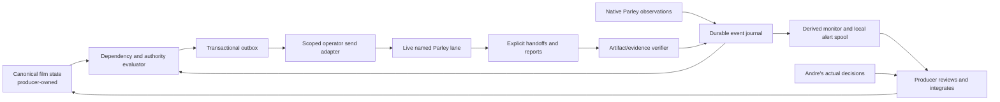

# Agent Parley integration and project monitoring design

**Design status: proposed; implementation and activation are not performed by this plan.** Exact installed-source references and capability limits are in [the Parley audit](../../../../reports/execution-plan-v1/parley-audit/README.md), with [source hashes](../../../../reports/execution-plan-v1/parley-audit/source-evidence.json). Live readings are in [baseline evidence](../../../../reports/execution-plan-v1/baseline/capture.json). The [upstream project](https://github.com/suneel944/agent-parley) is an additional documentation reference; the local installation and observed sessions govern this deployment.

## 1. Architecture choice

Keep the daily Parley installation for its existing identity, separate worktrees, native lifecycle hooks, messages, advisory reservations, reports and bounded lane supervision. Add a **project-local coordination layer** that understands exact film inputs, task scopes, approvals, verification and successors. Do not replace Parley or embed film rules in its global installation.

The runtime journal stores coordination state, not a rival production board. The monitor is a derived view. Only the producer changes canonical approvals, decisions, board, manifest, ledger, asset registry and STATE/session-log integration. An automatic policy may release an already-authorized local zero-spend assignment after activation; it cannot decide to buy media, accept a face, change voice approval, commit, merge or publish.

Implement O03–O13 in the proposed `scripts/production_*.py` modules named in the catalogue, with stdlib storage/tests where practical. The audit appendix also discusses a possible `scripts/coordination/` layout; that is an alternative proposal, not a second implementation to build. Select one coherent layout at implementation kickoff.

## 2. Actual native hook contract versus new film events

| Installed native event | Safe interpretation | Project use | Must not imply |
|---|---|---|---|
| `SessionStart` | A native session started/checkpointed | Verify participant/session, current contract hash and assignment revision | Film task accepted or healthy visual review capability |
| `UserPromptSubmit` | User input entered the native session | Check changed direction and invalidate affected task scope | Broad authorization extracted from arbitrary prompt text |
| `PreToolUse` | Tool execution is about to be evaluated | Preserve native branch/reservation guards; optional bounded observation | Blanket enforcement of film payment or personal approval rules |
| `PostToolUse` | A tool action returned | Record progress metadata; discover explicit handoff publication | Artifact complete, correct or accepted |
| `PermissionRequest` | Native permission interaction blocks affected activity | Mark human attention with exact blocked action | Permission may be auto-granted by the dispatcher |
| `Stop` | Turn/lane reached a stop point | Reconcile outstanding assignment/report | Task succeeded or successor should start immediately |
| `SessionEnd` | Session ended | Recheck liveness, preserve ownership and incomplete work | Ownership transferred or cleanup authorized |
| Claude-only modeled `PermissionDenied` | A native action was denied | Hold affected action and surface reason | A supported equivalent in every Codex client |

These are installed-source capabilities. Runtime execution and hook composition still require explicit tests. Notifications such as `handoff_offered`, `run_finished` and `lane_blocked` are a separate Parley notification domain, not native hook registration names.

Define new project events under `film.*`: `assignment.prepared`, `assignment.sent`, `assignment.accepted`, `work.started`, `handoff.submitted`, `handoff.verified`, `review.failed`, `blocker.changed`, `approval.observed`, `successor.accepted`, `stage.closed`, `dispatch.failed`. They are **new schema values**, not built-in hooks. `approval.observed` records a reference to an actual producer-integrated decision; it cannot create approval.

## 3. Wiring strategy without global breakage

First use supported Parley CLI snapshots/reports and explicit handoff publication. Preserve launcher-injected native hooks. The native hook budget is three seconds; the optional recorder should aim for a measured ≤100 ms p95 of its own work, and do only bounded sanitized spool writes. Media hashing, rendering, provider requests, mail send loops and evidence evaluation run outside synchronous hooks.

Before adding a project hook, test effective composition in a disposable lane for the actual Codex and Claude client versions. Codex launcher command-line hook settings may override project files. If composition fails, retain explicit handoff publishing plus observation instead of editing the installed package or weakening trust. Any launcher enhancement belongs in an isolated separately scoped development change.

Proposed deployment modes: `disabled`, `observe`, `dispatch_local`. Default is disabled. Observe derives state and predicted next actions without sending. Dispatch_local permits only an explicit allowlist of versioned local documentation/review assignments. Hook events never directly call the paid runner. No hidden chat heartbeat is required; event-driven observation and bounded recovery reconciliation suffice. Any service interval is documented deployment configuration, not a recurring Codex automation created by this plan.

Runtime location proposed: ignored `.runtime/coordination/andre-time-travel/`, owner-only directory and files. Persist SQLite journal/outbox and lock there; export selected audit evidence under project reports. Keep provider secrets, bearer tokens and raw environment dumps out. Preserve daily `agent-parley` state separately from `agent-parley-dev`; never repoint one to the other.

## 4. Assignment contract

Use a versioned assignment packet, derived from the handoff-v2 design, with:

- Episode, plan package ID and parent production task; assignment ID and revision; source and contract hashes.
- Named film role, actual participant/session generation and producer custodian; capability requirement.
- Allowed operations and exact new output paths; prohibited canonical writes; spending always zero for automated tasks.
- Input paths, hashes, versions and approval/use scope; inherited decisions only by reference.
- Steps, completion checks, required playback/visual/audio evidence and known limitations.
- Separate readiness predicates: available inputs, dependencies, recipient availability, reservations, authority and human gates.
- Acknowledgement deadline, work deadline if useful, retry policy, stop conditions, successor candidates and fallback owner.
- Idempotency key and normalized payload digest; changed content gets a new revision/key.

Only safe relative project paths are accepted in data. Reject traversal, outside-root symlink resolution, credential-bearing fields and arbitrary command strings. The dispatcher maps allowlisted action identifiers to fixed argument arrays; it does not execute command text received in a report.

## 5. Lifecycle and ownership

`prepared → queued → sent → receipt_observed → scope_accepted → running → submitted → verified → successor_pending → successor_accepted | stage_closed`

Alternative states: blocked_dependency, blocked_human, blocked_scope, blocked_resource, transport_uncertain, expired_unaccepted, superseded, failed_verification, attention_required and cancelled. Cancellation preserves artifacts and records who owns unfinished work.

Read/ack evidence is communication evidence. Scope acceptance additionally echoes assignment ID/revision, role, input versions, allowed writes and stop conditions. Running requires a work-start receipt or actual scoped activity; a live process alone is insufficient. Submitted is an executor claim. Verified requires checks against exact output bytes and acceptance criteria, including real temporal review where required.

The producer owns undispatched, unaccepted and verified-but-unassigned next work. Deadlines and process exits do not move responsibility. A delivered task closes operationally only with an accepted successor, a specific blocker with owner and unlock condition, or a terminal authorized stage. If a reviewer fails a deliverable, route the bounded defect list to the original owner; do not regenerate an entire chapter automatically.

## 6. Actual communication route for this desktop producer

The current operator is a CLI-only sender with no lane credential. The installed store rejects ordinary lane messages addressed to operator. Therefore use this explicit route:

1. Producer sends a bounded assignment through the supported operator CLI.
2. Lane reads and acknowledges natively, then writes an acceptance report/receipt with assignment revision, contract hash and scope.
3. Producer adapter reads that report and verifies the associated local handoff from the registered worktree; it records receipt and scope acceptance separately.
4. Lane records progress/blocked/ready report and versioned output handoff. Producer reads back evidence and verifies it.
5. Producer either sends the next scoped assignment and verifies acceptance, records a blocker, or closes a terminal stage.

Handshake proof uses both directions without pretending the lane can mail operator: producer sends challenge A; lane report echoes A and proposes B; producer sends B back; lane report confirms B and the shared task/contract version. Record IDs, hashes, session generation and timestamps. Do not claim success from only a watcher event or outbound send.

Both film lanes are currently dead. Restoring them requires the intended native user-terminal launch and approval interaction. Do not start nested interactive agents from a tool or automatically enable bridge/auto-mode. The desktop conversation is not a launcher-managed lane. Native lane wake capability does not prove this desktop chat will wake.

## 7. Durable store, idempotency and recovery

Use a single local SQLite database with WAL, foreign keys, bounded busy timeout and explicit migrations. Suggested tables: events, source_cursors, assignments, assignment_transitions, outbox, deliveries, review_receipts, blockers, resource_claims, dead_letters, settings_versions. Store references/hashes to canonical files rather than editable copies of their approvals/status.

Unique keys:

- Observation: source + source-generation + event ID.
- Assignment: episode + package + input-fingerprint + revision + recipient-session.
- Transition: assignment + revision + transition + payload digest.
- Outbox: assignment + revision + action kind; exact transport payload digest retained.

In one transaction ingest the event, evaluate the saved source snapshot, append the permitted transition and create at most one outbox entry. A separate sender drains it. Record message ID/thread/key and result before acknowledging delivery locally. After a crash during send, mark transport_uncertain and reconcile the original operation. Retry only with the same supported idempotency identity and identical payload; never issue a new key to escape uncertainty. Zero-spend communication retry is unrelated to forbidden automatic generation retry.

One active coordinator holds a process lock and durable fencing generation. Stale instances cannot commit new transitions. Claim outbox rows atomically. A file handoff publishes by temp write, flush/fsync and atomic rename to a new unique revision. An incomplete JSON file or stable file size is not delivery. Cursor identity must handle log rotation/restart, not just byte offsets. Native hook evidence has bounded retention; export necessary proof before it disappears.

On restart: verify storage integrity and schema, read deployment mode, validate lock generation, reload exact policy/contract hashes, reconcile uncertain sends and active assignments, refresh liveness, recheck unconsumed handoffs, recompute only affected readiness, and resume outbox work if mode and scope allow it. Do not replay every historical event as a new assignment.

## 8. Resource and authority checks

Parley file reservations are advisory. Reserve assigned outputs and named contested resources; a queued reservation is not ownership. Expired TTL does not imply released paths. Use cross-project host leases only for genuinely shared hardware/ports, with exact lease IDs and explicit release. The producer alone owns any `kling:submit` resource.

The local policy must reject automatic requests for media generation, purchases, token access, global settings, canonical approval writes, commit/merge/push, external message transports and personal acceptance. Existing Parley reports, `decision:true` markers and budget displays do not override those checks. The existing paid runner's nonempty authorization field is not a verified financial gate; O19 specifies a separate exact-scope preflight, still used only by the producer.

This constrains the dispatcher, not every process on an unrestricted host. Native hook guards, project rules, reservations and operator checks have different scopes. Do not claim violations are technically impossible.

## 9. Monitoring and actionable alerts

Expose a derived local view with: production task and plan package; assigned owner/role/session; input revision; lifecycle state; last meaningful activity; report/output evidence; verification status; blocked reason/owner/unlock condition; successor acceptance; unresolved transport; and budget/approval warnings as references, never inferred live balances.

Show separate evidence levels: configured, service-ready, session-live, sent, received, accepted, running, submitted, verified, artistically accepted. Provide links to actual captures. Suppress unchanged alerts. Notify on failed verification, lost recipient, native permission attention, unresolved send, changed approved input, overdue acceptance, missing successor, or completion requiring producer action. Store local alerts durably even if a UI cannot wake.

Parley's external notifications are currently off; its installed transports are Telegram/email. Adding a destination or external transport is a separate scoped action. No external send, automatic desktop wakeup or push-notification guarantee is part of this plan.

## 10. Stop and rollback

Disable future outbox sends first; retain accepted work ownership and journal. Do not kill unrelated lanes, provider jobs or daily services. Reconcile any in-flight send before declaring stopped. Export pending assignments, evidence and blockers; restore prior project adapter configuration only after checking concurrent edits. Verify manual producer dispatch/report-readback still works. A rollback preserves every media file, approval, ledger entry and unfinished owner.
