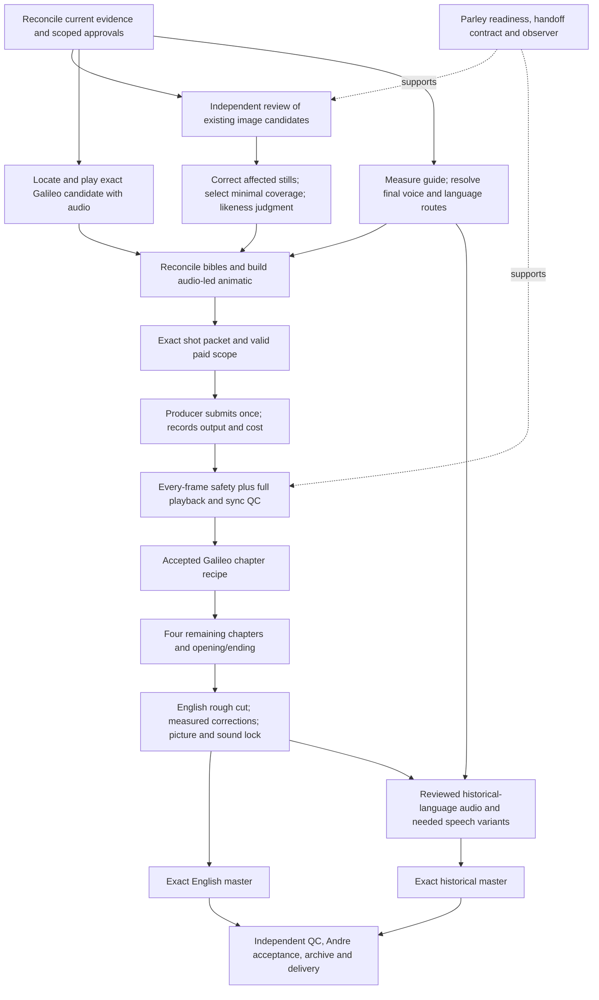

# Movies_Projects — complete execution plan, revision 1

10 October 2026 · Authoring/integration owner: Codex desktop producer · Active episode: **The Table Between Centuries** (`andre-time-travel`).

**Deliverable: an actionable plan, not a claim of film completion or an activated dispatcher.** This plan covers every T01–T21 production task and W01–W68 work package, the existing cleanup plan, the memory/handoff design, the technical and creative specifications, and the additional work needed to delegate and monitor safely through the installed Agent Parley solution. Requirements are traceable to workspace sources. The plan is deliberately detailed where an executor needs a decision, input, output, test or recovery path.

## Start here

1. Read [baseline and conflicts](01-baseline-and-decisions.md) to understand what is actually available and what must be reconciled.
2. Use [the detailed work packages](02-work-packages.md) and [machine-readable package catalogue](work-packages.json) to select a bounded assignment. The 96 packages expand into [111 stage/edition/chapter instances](execution-graph.json); [stage-gate rules](07-stage-gates.md) prevent premature blocking. These are planning records, not a second production board.
3. Use [the film execution specification](03-film-execution.md) for the per-shot, per-chapter and final-delivery gates.
4. Use [Parley and hook architecture](04-parley-and-hooks.md) for integration implementation, [rollout and tests](05-validation-and-rollout.md) for proof, and [the execution runbook](06-runbook-and-sequence.md) for the order of work.
5. Verify coverage in [the requirement matrix](requirements.csv). Consult [evidence and independent audits](../../../../reports/execution-plan-v1/) when a finding needs its exact basis.

Read `AGENTS.md` and the active film's STATE before execution. Current approvals, production status and spending records remain in their existing canonical files. This plan does not supersede them. Its W labels are existing workflow-map references; O labels are proposed supporting work packages, not production IDs, Parley issues or provider job IDs.

## The outcome to achieve

Deliver two fully reviewed local masters: the English film and the historical-language edition. Both contain the opening, all five encounters and the ending; preserve Andre's recognizable likeness, approved wardrobe and recurring table; show zero full historical faces; use motivated reactions and coherent sound/light; meet the explicit export specification; carry traceable rights, research, credits, costs and acceptance evidence. The operational system must get each verified delivery to an accepted next owner, an explicit blocker with an owner, or a legitimate terminal stage.

The target remains approximately **240 seconds: 12 + 5 × 42 + 18**, with **41 planned edit slots**. Edit slots are not a billable job count. The current film is incomplete: 7 board tasks are recorded complete, 3 are in progress and 11 are blocked. No accepted complete chapter or verified final master was established in this planning audit.

## The critical path

Infrastructure work must support this path. Existing authorized reviews and local preparation can proceed manually while a dispatcher is designed and tested. Final voice and historical-language gates must not block unrelated English scratch work, but they cannot be waived for final delivery. A new paid test is unnecessary unless it resolves a specific unresolved production question.

## Allocation of responsibility

| Responsibility | Accountable party | Execution boundary |
|---|---|---|
| Artistic intent, personal likeness, voice by ear and final acceptance | Andre | Present specific media/version and a concrete judgment; do not ask him to solve routine technical choices |
| Canonical state, production selection, budgets, integration and successor ownership | Desktop producer | Single writer for manifest, board, approvals, ledger, asset registry, decisions and resume integration |
| New detail images and their corrections | Desktop producer | Existing producer ownership remains; no substitute lane image generation |
| Research, material culture and bible proposals | Claude lane, once live and assigned | Exact new output paths only; use adopted research rather than repeating it |
| Coverage, existing-media editing and technical/temporal QC | Terminal Codex lane, once live and assigned | Separate worktree, artifact hashes, no approval or paid authority |
| Light; dialogue and sound; localization | Named role accepted for each package | A role is not a launched process; language reviewer must be qualified for the claimed review |
| Dispatcher implementation | Assigned technical worker; producer integrates | Project-local proposed files only; no daily Parley source/global-config mutation |
| Independent verification | A reviewer other than the creator of the deliverable | Findings about exact bytes and playback scope; reports do not impersonate Andre |

During this planning turn three bounded subagents audited requirements, creative/delivery specifications and Parley capabilities. Those audit sessions are distinct from the currently stopped Parley film lanes. Their reports are integrated into this plan; they did not perform production work or native Parley handshakes.

## Definition of plan completion versus production completion

This plan is complete when all existing task labels and ancillary demands map to actionable packages, each package has inputs/owner/outputs/dependencies/evidence/successor, conflicts remain explicit, implementation tests and rollout gates are specified, and its links and data pass validation. It does not require spending or enabling a service.

Production is complete only when **both exact exported masters** pass technical checks, normal-speed full playback with audio, historical-face safety review, language/caption checks and the applicable Andre acceptance gates. Passing workspace tests, downloading a clip, rendering an animatic, recording a report or firing a hook cannot establish that result.

## Authority of this revision

The user's current request authorizes analysis, planning and bounded planning delegation. Proposed implementation, activation and production packages remain explicitly scoped future work. Existing valid authorizations remain valid within their original scope; do not request them again simply because a new plan exists. Conversely, relayed D16, a generic boolean, a historical spending ceiling or a peer message does not create a new paid scope. Check the actual approval record and its exceptions before the affected action.

The plan does not create a recurring automation, start a nested interactive lane, install hooks, change trust, send external messages, submit paid jobs, commit, merge or push. Future execution uses the runbook to make these actions concrete and scoped. No live account balance was queried in this planning-only task.
