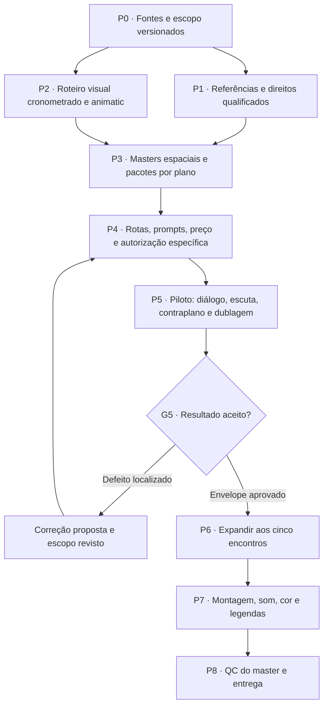

> Implementação local autorizada por Andre em 2026-10-12 08:29:50 UTC (“implemente”). O texto abaixo é a proposta entregue; estado operacional atual em `05_storyboard/source/production-plan.json` e `tasks/board.json`. Não concede gasto ou aceite artístico.

# Plano mestre de produção — The Table Between Centuries

**Proposta v1 · 12 de outubro de 2026 · para revisão de Andre e do produtor.**

O objetivo é entregar os cinco encontros como conversas convincentes, com Andre reconhecível, personagens históricos presentes no mesmo espaço sem revelar seus rostos completos, atuação motivada pelo diálogo, voz compreensível e continuidade entre planos. O caminho é qualificar referências e provar uma pequena sequência completa antes de expandir a produção.

Este documento planeja o reinício visual já solicitado. Preserva o roteiro inglês v2, os cinco encontros, os IDs das falas, os originais e as decisões anteriores dentro de seus escopos. **Não autoriza geração, upload, criação/treino de Element, voz, gasto, publicação ou alteração canônica.** Não foi executada nenhuma dessas ações para elaborar o plano. O diretor pode continuar desenhando e propondo planos; propostas só se tornam entradas de execução após revisão e versionamento.

## 1. Resultado final e critérios que governam o trabalho

Entregaremos uma edição inglesa completa e, separadamente, a edição em línguas históricas quando as traduções, pronúncias, vozes e sincronismo próprios estiverem qualificados. A edição histórica não impede concluir a inglesa e não recebe aprovação por herança.

| Resultado | Critério de aceitação |
|---|---|
| História e interpretação | Texto e IDs preservados; intenção específica por encontro; reação depois da ideia que a provoca; arco de Andre: fluente → mais lento → caloroso → confrontado → silêncio. Diálogo continua identificado como ficcional. |
| Identidade | Andre reconhecível nos ângulos e movimentos usados, sem troca de rosto, idade aparente ou cabelo. Aprovação de semelhança por Andre, vinculada à versão e ao uso. Um piloto antigo não aprova todos os derivados novos. |
| Espaço compartilhado | Mesa, cadeiras, distância, altura, direção dos olhares e luz coerentes entre estabelecimento, fala, escuta, reação e saída. O espectador entende onde cada pessoa está. |
| Segurança de enquadramento | Zero quadros com rosto histórico completo, inclusive reflexos. Planos de costas, ombros, olhos e detalhes têm limites definidos e inspeção temporal; não basta um prompt dizer “no face”. |
| Voz e som | Falas inteligíveis e completas, intenção e pausas aprovadas, voz final julgada por ouvido. Boca visível sincronizada com o áudio final. Ambiência e foley pertencem ao espaço e continuam entre cortes. |
| Montagem | Cobertura suficiente para contar cada troca sem repetição decorativa, ausência de saltos não intencionais de eixo/posição e transições que preservam a identidade. |
| Entrega | Master exato assistido integralmente com som; decodificação, cor, níveis, legendas, duração e créditos conferidos; arquivos locais, hashes, fontes, direitos e decisões rastreáveis. |

Os antigos 240 s, capítulos de aproximadamente 42 s e 41 slots são uma referência de planejamento, não obrigação de preencher silêncio com novos vídeos. O animatic apresenta a duração resultante das falas, pausas, reações e créditos; Andre aprova o ritmo antes de liberar a expansão. Nenhuma redução ou alteração do texto ocorre silenciosamente.

## 2. O ponto de partida: existente, a qualificar e a criar

Inventário detalhado: [diagnóstico](reference-inventory.md). `F/` abaixo significa `projects/andre-time-travel/`, relativo a `/mnt/data/Projects_SSD/Movies_Projects`.

| Área | Já existe e pode ser examinado | Falta qualificar/selecionar | Falta criar ou completar, somente se necessário ao plano escolhido |
|---|---|---|---|
| Roteiro | `F/01_script/script-en.md`, `dialogue-lines.csv`, D07, pesquisa histórica adotada | Marcar tempo e palavra de reação, interpretação e boca visível por plano, sem reescrever falas | Roteiro visual cronometrado e animatic novos; eventuais propostas de texto ficam separadas para decisão explícita |
| Identidade | 13 fotos reais da sessão; quatro recortes selecionados; Element **323525046658711** documentado como imagem com voz associada | Comparar referências com o novo enquadramento; readback sanitizado do Element quando a rota exigir, sem alterar recursos | Fotos/atuação novas apenas para ângulos ou ações não cobertos; não exigir uma sessão completa para um plano frontal simples |
| Corpo e roupa | D02, fotos do casaco cinza e camisa listrada; perfis e poses sintéticos | Separar identidade real de estilo sintético; selecionar roupa, grooming, acessórios e limites de movimento | Cobertura real de perfil/¾/corpo inteiro ou gesto, caso o diretor escolha planos que precisem dela; nenhum turnaround real aprovado foi localizado |
| Espaço | Mesa J26-2, placas de cinco épocas e presente, propostas de escala/coordenadas, eixo D09 | Escolher mesa/assentos/luz compatíveis; conferir mancha e lasca; geometria 120×75×75 cm é proposta, não medida/aceite | Master espacial e planta simples por encontro, derivados aprovados de fala/escuta e referências de contatos/escala ausentes |
| Imagens de plano | 12 keyframes de fala/escuta; dez IN/OUT; 26 estudos ativos de mãos, pés, costas e ombros | Aprovação de semelhança, materiais, eixo e enquadramento; evitar versões superadas e ombro direito como seleção implícita | Somente keyframes/ângulos que a cobertura escolhida não consiga aproveitar; IN/OUT existentes não são pares first/tail já testados |
| Atuação | Pilotos sintéticos, takes antigos; **66 MP4s históricos** no inbox; registro de Motion 1 de 30 s | Ver conteúdo, cortes, ângulo, duração, corpo/rosto, som e direitos dos poucos candidatos pertinentes | Uma gravação curta de atuação somente se nenhum candidato servir. **66 vídeos antigos não significam uma acting reference aprovada** |
| Voz | Cinco testes ElevenLabs, uma amostra no inbox, 22 arquivos scratch, guias Galileo | Andre escuta e decide; verificar consentimento/uso, pronúncia, intenção e qualidade da amostra. `voiceTests=false` | Renders finais e stems por linha, vozes consentidas/projetadas dos interlocutores, eventualmente captura real. Qualquer serviço/treino/extração exige escopo próprio |
| Continuidade temporal | Pilotos e preview Galileo; notas F01/F03; A/B de escuta | Rever o material exato e decidir o que é aproveitável como referência; não perpetuar mesa/assento divergentes | Piloto da nova linguagem visual, depois cobertura faltante por encontro; montagem e som finais |

Os dois A/B custaram **51 créditos** e estão encerrados. Testaram escuta com ambiência baixa, uma imagem e nenhum Element: não validaram fala, voz vinculada, transferência de atuação nem continuidade entre planos. O antigo teto não autoriza outro job.

## 3. Direção continua aberta; execução usa versões estáveis

Andre é o diretor criativo e decide intenção, enquadramentos, presença dos interlocutores, ritmo e aceitação da própria aparência/voz. O produtor transforma a direção em pacotes executáveis e integra fontes; agentes propõem e verificam dentro do escopo atribuído.

Trabalharemos com dois estados distintos:

- **Proposta de direção:** desenhos, alternativas e novos planos podem continuar surgindo, com autor, data e propósito. Não substituem automaticamente um plano aprovado nem disparam geração.
- **Plano liberado para um take:** tem IDs, referências e hashes, linha exata, rota, configuração, preço, teto e aceite necessários. A versão usada é imutável no histórico. Mudou a composição? Cria-se revisão; só dependentes afetados voltam à análise.

O produtor apresenta alternativas pequenas e comparáveis ao diretor, com impacto de custo e continuidade, em vez de solicitar aprovações genéricas. Nenhum agente pode registrar aprovação em nome de Andre nem aprovar artisticamente sua própria criação. Autochecagem técnica é permitida e explicitamente rotulada; a aceitação exige outro responsável e, nos gates pessoais, Andre.

## 4. Sequência de resultados, dependências e gates

Os códigos P0–P8/G0–G8 identificam partes **desta proposta**, não tarefas já abertas no board ou novas autorizações.

| Fase e resultado concreto | Dependências | Responsável de execução | Gate e prova de pronto |
|---|---|---|---|
| **P0 — pacote de fontes**: roteiro/CSV, direção, decisões, inventário e escopo com hashes; divergências atribuídas a donos | Fontes existentes | Produtor | **G0:** produtor confirma preservação do roteiro e separação do restart; direção escolhe prioridades visuais. Sem transferir orçamento/aceite antigo |
| **P1 — seleção de referências**: contato visual pequeno, ficha por asset, direitos e limitações | P0; assets existentes | Continuidade + diálogo/som; historiador/material e iluminação onde necessário | **G1:** uso proposto documentado; Andre avalia sua aparência e voz no material selecionado; lacunas específicas listadas. Não precisa esperar voz final para preparar imagem com guia D14 |
| **P2 — roteiro visual e animatic**: falas, pausas, reações, cobertura e duração real | P0; scratch existente; propostas P1 | Diretor/storyboard + editor + diálogo/som | **G2:** Andre aprova causalidade e ritmo; produtor valida IDs e dependências. Animatic com guia é identificado como tal, sem fingir voz final |
| **P3 — pacote espacial e keyframes**: master, planta, eixo, luz, escala, início/fim e referências por plano | G1 visual + G2 | Storyboard/continuidade + iluminação; criador de imagens em atribuição separada | **G3:** continuidade/material revisados independentemente; Andre aprova semelhança/composição do conjunto selecionado. Imagem criada não se autoaprova |
| **P4 — plano de execução**: rota/contrato, prompt por família, entradas, custos e autorização | G3 e texto/tempo estáveis; contrato aplicável | Produtor técnico + revisor de contrato | **G4:** todos os parâmetros/combinações validados, preço da superfície correto e teto específico aprovados; uploads/voz/Elements cobertos separadamente quando aplicável |
| **P5 — piloto da nova sequência**: fala, escuta e contraplano com geometria comum; prova de voz-guia e de substituição futura | G4; pacotes de três funções visuais; áudio permitido | Produtor submete; editor monta; QC independente revisa | **G5:** passagem pelos gates visual, áudio, continuidade e pessoal descritos na seção 8. Falha exige diagnóstico e decisão, nunca retry automático |
| **P6 — cobertura dos cinco encontros**: lotes pequenos vinculados ao animatic | G5 no envelope aplicável, orçamento atualizado | Produtor + donos por área | **G6 por encontro:** take/linha aprovados; continuidade entre planos e transições conferida. Novo ângulo/ação/rota fora do envelope volta ao gate pertinente |
| **P7 — montagem final e versões de áudio**: picture lock, diálogo final, foley/ambiente/música, cor, legendas | Cobertura aceita; voz final e direitos aprovados | Editor, diálogo/som, colorista, legendagem | **G7:** diretor aprova corte; QC revê sync, mix e cor nos arquivos exatos. Guia pode sustentar preview, nunca ser rotulado como voz final |
| **P8 — master e pacote de entrega** | G7; revisão da língua na respectiva edição | QC independente + produtor | **G8:** reprodução integral com som, validações técnicas e aceite final de Andre; proveniência completa. Publicar/distribuir segue autorização própria |

Preparação local de P1/P2 pode ocorrer em paralelo com donos distintos. A criação de mídia de P3 e a execução de P4/P5 não estão autorizadas por este plano. Não atribuímos calendário fictício: duração da etapa depende de revisão humana, assets escolhidos e tempos do serviço; prazo será reestimado após o animatic e o piloto.

## 5. Roteiro cronometrado e proposta de cobertura dos cinco encontros

Preservar `script-en.md` e `dialogue-lines.csv` como fonte do texto. Criar uma tabela derivada de montagem com `line_id`, áudio usado/hash, duração medida, in/out de fala, pausa, gesto, palavra que provoca reação, plano/boca visível e estado inicial/final. Ouvir as 22 falas existentes para confirmar se servem como guia; as medidas abaixo são registros anteriores, não nova audição nem aprovação.

| Trecho | Fala-guia registrada | Necessidade dramática e visual a desenvolver |
|---|---:|---|
| Abertura | 5,83 s | Mesa e chegada contextualizam Andre. Rosto preservado; transição motivada pela madeira/gesto, sem portal sobre o rosto |
| Caesar | 19,99 s | Confiança em “It survives”; mudança após “survive you?”. Estabelecer pessoa, mesa e distância. Não reduzir o personagem a olhos decorativos |
| Genghis | 21,39 s | Orgulho → gravidade em “no longer there”, sustentada em “the dead speak”. Usar roupa dos estudos D20 sem armadura somente após seleção para a nova cena; conferir assento e escala |
| Galileo | 23,30 s | Atenção em “more interesting”; resolução em “does not settle a question”. Corrigir incompatibilidade mesa/assento e reação que antecedia sua causa |
| Napoleon | 20,12 s | “outlives your throne”; N-L03 devolve a pergunta a Andre e N-L04 expõe seu limite. Não inventar nova fala. Reação após “who pays it”; figurino/bicorne selecionados |
| Oppenheimer | 20,45 s | Mudança em “Hiroshima”; resposta O-L04 e **pelo menos 4 s de silêncio** antes do corte, como está no roteiro. Risco de reflexo/fumaça e lacuna de bible v3 exigem resolução visual |
| Encerramento | 9,72 s | Responde à virada de Napoleon, volta à cadeira vazia e à mesa, com aviso de ficção e créditos. Ritmo do silêncio/cauda decidido no animatic |

Fala total registrada: **120,8 s**. O restante do filme é construído com presença, escuta, pausas, gesto, transições e créditos, não automaticamente completado até 240 s. Se a interpretação aprovada durar mais, ajustar cobertura/duração; mudar palavras exige decisão explícita sobre o roteiro e seus derivados.

Cada encontro recebe apenas a cobertura necessária: estabelecimento de espaço compartilhado; Andre ouvindo/falando; contraplano seguro ou reação; detalhe útil; saída. Não há obrigação de repetir olhos+mãos+pés em todos. O contraplano histórico não precisa mostrar o rosto: olhos recortados, postura de costas e detalhe espacialmente situado cumprem a função, desde que diretor e montagem os escolham. Não gerar reverso frontal por automatismo.

## 6. Pacote de referências por plano

Antes do prompt, o plano precisa de uma ficha com estas funções separadas:

| Camada | Conteúdo necessário | O que não pode ser inferido |
|---|---|---|
| Identidade | Foto real/Element exato, versão/readback, vistas permitidas, semelhança aprovada no uso | Element facial não fixa automaticamente cabelo, roupa, corpo, mesa ou atuação |
| Corpo/figurino | Frente/costas/perfil necessários, caimento sentado, grooming, mãos/acessórios, direção do corpo | Foto de cabeça não comprova corpo inteiro; perfil sintético não equivale a captura real |
| Espaço/escala | Master comum, dimensões propostas aceitas, assentos, posição da mesa/manchas, altura/distância/focal da câmera, olhares | Placas de época isoladas não provam que dois personagens dividem a mesma mesa |
| Luz e materiais | Fonte motivada, lado da luz, intensidade/cor relativas, exposição de pele, piso/tecido/props e contatos | “cinematic” não define continuidade; reconstrução artística não é fato histórico comprovado |
| Atuação | Intenção, estímulo, mudança, início/fim; vídeo de atuação qualificado se a rota depender dele | Vídeo antigo, nome “Motion1” ou pose bonita não comprova gesto adequado, direitos ou qualidade |
| Voz/linha | `line_id`, texto exato, voz-guia/final, áudio/hash, duração/pausas, autorização e revisão | Voz ligada ao Element não é arquivo guia por take nem prova de timbre reconhecível; STT correto não é aceite vocal |
| Enquadramento/continuidade | Keyframe, crop seguro, câmera, estado dos objetos/olhares, handles de montagem, sucessor | First/tail define âncoras, não garante trajetória entre elas; barras/crop não garantem zero revelação durante o vídeo |

Cada asset terá origem, autor/provedor, arquivo/hash, real/sintético, uso permitido, status (`candidato`, `selecionado`, `aprovado para uso específico`, `rejeitado`), revisor e limitações. Essas são categorias propostas de trabalho; o produtor mapeará para os estados válidos do sistema ao integrar, sem inventar enums canônicos nesta etapa.

Para escala, resolver por uma composição única verificável antes de derivar planos. A proposta 120×75×75 cm e as coordenadas existentes são pontos de partida; o diretor pode escolher outra geometria coerente. Conservar os marcadores da mesa J26-2 e a regra do eixo D09 enquanto não houver decisão explícita que os altere. Ombro direito não substitui automaticamente o esquerdo.

Para atuação, selecionar poucos vídeos por gesto necessário, não revisar 66 arquivos sem prioridade. Conferir normal speed, cortes, obstruções, identidade autorizada, direção, duração, corpo e áudio. Se nenhum servir, descrever uma captura mínima: um único intérprete consentido, enquadramento compatível, luz estável, gesto e pausas exatos, sem cortes; duração e formato da **rota escolhida**. Não reutilizar terceiro ou extrair/clonar sua voz por constar no inbox.

## 7. Seleção de modelos e prompts por família

Base técnica: snapshot Global CLI em 12/10/2026 04:07 UTC, MCP 1.3.3, e `tool_list` de 09/10. Ver [matriz completa](inventory-evidence/MATRIZ-SCHEMAS.md). Antes de uma futura execução, revalidar a combinação pela CLI autorizada; presença no catálogo não é preço, qualidade ou autorização. **V4 não é dependência deste plano.**

### 7.1 Escolher uma rota por necessidade

| Necessidade | Candidato apoiado no contrato arquivado | Limites e decisão necessária |
|---|---|---|
| Still de identidade/espaço | `image_to_image` / `kling-image-o1`, com fotos/imagens e Element de imagem, se compatível | Até 10 imagens e 10 Elements declarados; resultados antigos favorecem o1 na amostra local, não garantem nova cena. Escolher o mínimo de referências por função |
| Diálogo visível com guia nativa | `image_to_video` / `kling-video-v3_0` | First/tail; Elements≤3; áudio nativo e multi-shot. Definir `enable_audio=true`, `prefer_multi_shots=false` para plano único. Não declara MP3 independente. D14 continua tratando timbre como guia |
| Imagens múltiplas/Element de vídeo | I2V / `kling-video-v3_0_omni` | Slots `image_1..7`; Elements compatíveis; áudio e multi-shot. Sem vídeo direto nessa ferramenta. Criar novo Element de vídeo seria ação/escopo separado, não pressuposto |
| Escuta, olhos ou inserto com imagem única | I2V / V3 ou Turbo, conforme controle necessário | Turbo não tem Elements, tail nem flag explícita de áudio. Útil apenas se keyframe/envelope provarem a necessidade. Os A/B não garantiram uma piscada; áudio inesperado precisa ser avaliado/separado na edição |
| A→B com âncoras inicial/final | I2V / V3 (`first_image`,`tail_image`) | Qualificar ambos no mesmo espaço e medir movimento. Não confundir com “até 10 keyframes” de produto não disponível. Resultado intermediário ainda precisa de QC |
| Transferir atuação de um vídeo | `motion_control` / V3 | Imagem + exatamente vídeo ou motionId; Element≤1; `keepOriginalSound`. Imagem define aparência/cena, vídeo atuação, Element facial rosto. Guia atual restringe binding/orientação; confirmar compatibilidade por superfície. Não é lip-sync externo garantido |
| Editar/referenciar vídeo diretamente | `omni_ref_video` / V3Omni | `video_1` direto é diferente de Element criado de vídeo. Contrato arquivado exige `enable_audio=false` com vídeo; `keepOriginalSound` separado. Limites condicionais de imagens/Elements e tipo não permitem simplesmente juntar tudo |
| Dublagem final externa | Serviço/rota de sync qualificado separadamente, ou cobertura com boca oculta aprovada | Não enviar MP3 a uma ferramenta que não o declara; acesso, formato, custo, consentimento e qualidade próprios. D14 cita fallback, não o autoriza automaticamente |

Não se promete **Motion Control + voz independente + vídeo de referência + Element** como uma única combinação. Recursos de uma ferramenta não são automaticamente transferidos à outra; `keepOriginalSound` preserva áudio de origem, não seleciona/clona uma voz. Nas rotas Omni com vídeo, validar também as exclusões de Element vídeo junto com imagens/Elements de imagem.

### 7.2 Família de prompt e ficha obrigatória

Exemplos de autoria por família: [anexo de prompts propostos](ANEXO-PROMPTS-PROPOSTOS.md). São rascunhos de preparação, não mudanças nos templates canônicos.

Estes são **contratos de autoria para preparar prompts**, não comandos ou specs liberados. O texto final dependerá das referências selecionadas e será revisado antes de qualquer gasto. Mantemos o diálogo inglês canônico e marcadores técnicos exatos; o português explica intenção e decisão.

| Família | O prompt precisa informar | Validação anterior e resultado esperado |
|---|---|---|
| **F1 — master/still espacial** | Composição e posições, papel de cada imagem, identidade/roupa, mesa/marcas, luz e limite do rosto histórico | Cada referência tem função sem conflito; aprovar geometria/likeness antes de derivar ângulos |
| **F2 — variante de fala/escuta** | Mudança mínima em keyframe selecionado; objetivo emocional, direção do olhar e boca em estado pertinente | Não recompor mesa/assento/luz sem intenção; comparar entrada/saída no mesmo espaço |
| **F3 — fala visível** | Falante/binding compatível, **linha exata**, intenção, pausa, silêncio final, câmera única e áudio pretendido | Duração medida+handles; texto reconhecido e ouvido, boca e rosto estáveis. Voz-guia não recebe aceite de voz final |
| **F4 — escuta/reação** | Estímulo ligado a palavra/linha e mudança interpretável, olhar, início/fim, câmera e enquadramento | Evitar automatizar uma lista de microgestos. Contagem exata de piscadas não é controle comprovado. Quando o roteiro pede uma, preservar o pedido e medir; alteração exige revisão, não omissão silenciosa |
| **F5 — olhos/mãos/pés/objeto** | Gesto relevante, contato com mesa/chão, crop seguro, continuidade de roupa/luz, som ou foley previsto | Anatomia, contato/sombra e zero revelação em todos os quadros. Uma mão isolada não é assumida compatível com motion_control que pede sujeito claro |
| **F6 — atuação por vídeo** | Identidade/cena que permanecem, orientação compatível e estado emocional; movimento vem da fonte qualificada | Conferir vídeo inteiro e duração; não pedir gesto oposto à fonte nem presumir que texto encurta 30 s para5s |
| **F7 — first/tail ou edição Omni** | Âncoras e mudança única; o que precisa continuar; funções/marcadores de referência da rota exata | Validar sintaxe do schema e limites combinados. Não testar vários tokens pagos para descobrir o que já está declarado |

Todo prompt/spec inclui ligação para plano/versão, hashes das referências, modelo/ferramenta, slots, parâmetros explícitos, texto canônico/line_id quando houver fala, exclusões de enquadramento e critério de aceitação. Ausência de suporte bloqueia só a combinação afetada, sem substituir ferramenta, referência ou voz por conta própria.

## 8. Piloto proposto: Galileo, do diálogo à continuidade

Escolha de planejamento: começar por Galileo aproveita pesquisa/keyframes e confronta F01 (mesa/assento) e F03 (reação antecipada). **Ainda não existe autorização para executar o piloto.** Não repetir os A/B de escuta como substituto deste teste.

Usar a pergunta **G-L03** e a resposta **G-L04**, sem criar texto novo. G-L04 tem 8,62 s no scratch existente; “fala curta” aqui significa uma única resposta, não um vídeo forçado a3 s. A frase completa precisa caber com pausas e handles dentro da duração efetivamente aceita pela rota. Um alvo de aproximadamente 11–13 s para essa tomada é apenas planejamento sujeito à performance, contrato e cotação; não uma submissão preparada.

| Função visual do piloto | Conteúdo e referência | O que precisa provar |
|---|---|---|
| Escuta/estabelecimento | Pergunta G-L03 fora de quadro; Andre escuta em composição compartilhada com ombro/costas seguros do interlocutor | Os dois pertencem ao mesmo espaço; olhar/corpo respondem à origem da voz; ambiência audível quando desejada |
| Fala de Andre | G-L04 integral, mesma geometria, roupa e luz; V3 nativo é candidato sob D14 | Identidade durante articulação, linha/pausa exatas, voz-guia inteligível, continuidade em relação à escuta |
| Contraplano/reação segura | Resolução de Galileo em “does not settle a question”, usando crop de olhos ou reação segura escolhida pelo diretor | Reação motivada, eixo correspondente, mesa/roupa/luz coerentes e nenhum rosto completo em qualquer quadro |

São três funções de cobertura, **não três jobs automaticamente necessários**. O animatic e a seleção decidem se uma tomada aceita cobre duas funções, se falta uma variação ou se convém dividir. Não reutilizar um take incompatível só para reduzir a contagem. O pacote de gasto lista a quantidade real antes da liberação.

Montar a sequência com pergunta offscreen, fala, reação e ambiente contínuo. Primeiro usar guia D14, claramente rotulada. Para liberar a expansão de fala visível com segurança de entrega final, acrescentar uma **prova limitada de dublagem**: uma linha em voz aprovada ou gravação consentida, sincronizada à boca do take aceito, por rota explicitamente compatível e autorizada. Se ela ainda não estiver autorizada/disponível, o piloto pode receber aceite visual provisório, mas não um “pipeline de voz resolvido”. Preparação dos demais encontros continua; expansão paga de falas visíveis aguarda essa prova ou uma alternativa de cobertura aprovada pelo diretor.

### Gates separados do piloto

1. **Arquivo/contrato:** ID real, resposta, custo declarado quando disponível, download original/hash, duração e streams, decode completo; nenhuma suposição baseada apenas em COMPLETED.
2. **Imagem:** playback completo em velocidade normal e inspeção de todos os quadros de risco; rosto/cabelo/boca/dentes/mãos estáveis, sem pessoa extra ou reflexo proibido, composição respeitada.
3. **Áudio:** ouvir integralmente em volume de reprodução declarado, com fones e alto-falantes quando possível; texto/inteligibilidade, timbre, pausas, cortes e ruídos. STT+diff auxiliam, não substituem ouvido. AAC e sinal não nulo não bastam.
4. **Continuidade:** comparar planos lado a lado e em sequência: escala, posição, eixo, direção/intensidade de luz, mesa/marcas, roupa, props e timing da reação.
5. **Sync:** conferir palavras de maior articulação e início/fim de fala; D14 usa cerca de 120 ms como alerta de deriva, não tolerância universal de aprovação. Julgamento visual/auditivo decide; silêncio de boca também é avaliado.
6. **Direção/aceite:** Andre aprova aparência e interpretação; julga a voz final por ouvido. QC independente registra resultados por arquivo/hash e limitações; produtor libera apenas o envelope comprovado.

Sem ferramenta/condição para ouvir ou assistir integralmente, registrar exatamente a limitação e manter o gate pendente. Não declarar aceitação por folhas de quadros, transcript, RMS ou feedback de outro arquivo. Qualquer normalização/mix/correção futura cria derivado; originais permanecem intactos.

Se falhar, localizar primeiro intervalo defeituoso, comparar entrada/configuração/saída e propor a menor correção. Não atribuir causa ao idioma, modelo ou número de referências com base numa amostra. Um novo take só existe com revisão, custo e autorização próprios; não renomear job para contornar um envio incerto.

## 9. Expansão aos cinco encontros

Após o piloto, fechar primeiro Galileo como sequência completa revisada; depois avançar por encontro, preservando a ordem narrativa C→K→G→N→O no corte. A ordem de produção pode agrupar famílias comprovadas quando isso reduzir custo sem misturar referências ou impedir revisão.

| Encontro | Pontos de atenção antes do lote |
|---|---|
| Caesar | Selecionar roupa atual e estudos feet-v2/shoulders-v2; manter escala da mesa e expressão ligada à pergunta sobre a república. Fontes históricas não aprovam automaticamente figurino/plano |
| Genghis | Reconciliar seleção D20 sem armadura com bibles antigas; altura do assento compatível com mesa; não converter gravidade em gesto estereotipado ou lágrima não pedida |
| Galileo | Mesma mesa/assento em fala e escuta; reação após frase; piso de Arcetri segue como incerteza, não precisão inventada |
| Napoleon | Base de olhos recast_2, mãos-v3 e figurino/bicorne escolhidos; N-L03/N-L04 são a virada de Andre; não usar ombro alternativo para cruzar eixo sem decisão |
| Oppenheimer | Completar ficha/cues v3 que faltam; silêncio de pelo menos 4 s preservado no conjunto, sem impor duração universal ao plano de olhos; chapéu/fumaça/reflexos seguros |

Para cada encontro: seleção mínima → lista de lacunas → orçamento específico → envio individual → QC → montagem parcial → revisão do diretor → próxima liberação. Um lote não deve gerar todas as alternativas antes de julgar a base. Novas ideias do diretor entram como revisões com impacto rastreado; o agente não sobrescreve a decisão para aproveitar um resultado acidental.

## 10. Vozes, consentimentos e edição histórica

**D06/D14 permanecem vigentes.** Os cinco testes ElevenLabs e a amostra existente são candidatos; a voz Kling foi rejeitada. O plano não declara a voz final aprovada nem autoriza clonagem/extração/treinamento. Usar semelhança e voz de Andre requer o escopo correspondente ao serviço e finalidade, preservando os consentimentos já dados sem ampliá-los.

Diálogo/som prepara uma seleção pequena dos arquivos existentes para Andre ouvir, acompanhada de texto, versão/modelo, duração e limitações. Se nenhum satisfizer, apresenta opções concretas: gravação real dirigida ou nova síntese consentida, com custo e qualidade esperados; nenhum serviço é contratado por inferência. Interlocutores usam vozes projetadas/consentidas, não clonagem especulativa de pessoa identificável. Registrar origem/licença também para música, foley e vídeos de atuação.

Para cada linha final: áudio seco separado por falante, versão do texto, pronúncia, intenção/pausas, duração real, revisão por ouvido e mapa de sync/shot. Quando se usa guia, manter rótulo explícito nos previews, stems e frontend. Dublagem não garante lip-sync: se a voz final mudar timing, ajustar performance/rota/edição com aprovação, sem acelerar voz nem ocultar sistematicamente falhas com cortes não decididos.

A edição histórica segue o mesmo significado e IDs, mas exige tradução a partir do roteiro preservado, retrotradução, pronúncia/nomes e revisor competente para cada idioma/registro. Suporte de idioma moderno não autentica dialeto histórico. Latim/mongol/toscano/córsego não podem ser “resolvidos” por uma lista promocional genérica; documentar suporte da rota, revisão e eventual adaptação moderna explicitamente aprovada. Reaproveitar imagens sem boca visível; segmentos de boca têm versões e QC próprios. Não usar áudio traduzido sobre articulação incompatível como master.

## 11. Orçamento por plano e submissão confiável

**Verba nova autorizada por este plano: nenhuma.** Os 51 créditos dos A/B são histórico encerrado. Não existe cotação nova para o piloto, Elements, áudio externo ou expansão; o plano não reutiliza o teto anterior de 300 ou o orçamento antigo do filme.

O orçamento será construído de baixo para cima a partir da cobertura escolhida:

`custo do plano = criação/qualificação externa autorizada de referências + vídeo(s) cotado(s) + áudio/sync externo cotado + derivados pagos explicitamente escolhidos`.

Registrar separado: estimativa de planejamento, preço exibido/cotação antes do envio, limite autorizado e cobrança efetiva. Não converter unidadesAPI em créditos consumer sem prova; saldo observado não é cotação. Diferença de saldo é observação sujeita à concorrência, não cobrança certa de um job. Custos de voz/Element não entram escondidos no custo de vídeo; eventual reaproveitamento é explicitado para evitar dupla contagem.

| Campo do orçamento de cada plano | Conteúdo necessário antes do envio |
|---|---|
| Identificação | plano/versão, propósito, linha, duração pretendida e duração da referência quando relevante |
| Superfície/configuração | conta/rota permitida, ferramenta/modelo, resolução, quantidade, áudio/Element/movimento e todos os extras que alterem cobrança |
| Preço | fonte oficial pertinente, horário, configuração conferida, valor/unidade; prazo/limitação da cotação quando houver |
| Limite | teto desse plano e teto do lote aprovados, consumo anterior do mesmo escopo e saldo observado antes da chamada |
| Itens adicionais | custo/escopo de upload quando aplicável, criação de Element/voz, áudio/sync, correção e reserva **ainda não liberada** |
| Parada | critério financeiro e artístico, responsável por decidir, nenhuma repetição automática |

Sem preço prévio verificável ou mecanismo confiável de limitar custo, não submeter para “descobrir quanto custa”. Quando não houver teto imposto pelo servidor, declarar a limitação e usar cotação conferida + envio único sob teto aprovado; não chamar esse procedimento de garantia técnica de preço. Definir limite de parada com margem antes do lote; reserva de correção não é autorização automática para gastá-la.

### Identidade dos jobs e retomada

- Um único produtor submete pela CLI oficial e pelo runner do projeto. Revisores não geram nem alteram autorização. Não se usa HTTP/MCP paralelo, leitura de credenciais ou novo login como atalho.
- Antes da chamada: validar o spec no schema do modelo, todos os slots/limites condicionais, aprovações, preço e hashes; gravar intenção durável com plano/job, comando/spec, entrada e custo previsto. Referências só são enviadas quando esse envio estiver coberto pelo escopo.
- Depois: persistir resposta e `generationId` antes de esperar; registrar `creditsConsumed` e sua origem quando retornado. Consultar o ID existente para retomar; baixar original, calcular hash, verificar mídia e registrar revisão separadamente.
- Timeout/retorno ambíguo sem ID vira **submissão incerta**: não repetir, não trocar nome, não presumir gratuidade. Reconciliar pelo canal autorizado antes de qualquer substituição.
- O runner recusa repetição quando há intenção/resposta; isso é uma defesa local, **não garantia de idempotência do provedor**. `taskTraceId` correlaciona, não deduplica por contrato confirmado. Nenhum retry automático ou job em background.

## 12. Montagem, som, cor, legendas e master

Editor trabalha com originais imutáveis e derivados versionados, preservando takes rejeitados/histórico. Montagem referencia arquivo/hash, take, linha e in/out; não depende de URL assinada do provedor. Antes de normalizar, aprovar canvas/fps/enquadramento do projeto; normalização é técnica em derivado, não cura de rosto, ritmo ou sync.

O corte segue a conversa: espaço compreensível, perguntas/escuta, fala difícil e reação causal. Usar L/J cuts quando escolhidos para o sentido e continuidade, não como justificativa automática para esconder boca defeituosa. Conservar mancha/lasca nos match-cuts relevantes e transições fora do rosto. Reações não precisam de duração idêntica; o silêncio específico de Oppenheimer permanece.

Som entrega stems separados de diálogo, ambiente, foley e música. Ambientes não reiniciam aleatoriamente a cada take; contato do pé, dedo/mesa, tecido e respiração têm fonte, timing e intenção. Silêncio deliberado continua possível. Aumentar sinal quase inaudível não transforma o A/B em prova de geração sonora bem-sucedida. Escolher alvo de loudness/true peak e formato de entrega **antes do mix final**, conforme o destino aprovado; medir e ouvir o resultado, sem inventar um alvo obrigatório agora.

Cor preserva pele de Andre e materiais da mesa dentro da luz de cada época; não força todos os encontros à mesma paleta. Conferir exposição, balanço, flicker, textura, artefatos e mudanças em cortes. Nenhuma decisão de upscale/4K como remédio para identidade.

Legendas inglesas e da edição histórica recebem revisão de texto, sincronismo, quebras, leitura e correspondência ao áudio real. Aviso de diálogo ficcional e créditos/fontes/vozes/direitos integram o pacote. Escolher destino, resolução, codec, fps, áudio, acessibilidade e variantes necessárias no gate de entrega, sem publicação automática.

Pacote final: master por edição aprovada; versão limpa/legendada apenas quando solicitada; legendas separadas; stems; timeline/projeto reproduzível; manifesto com arquivos/hashes; fontes/direitos/consentimentos; decisões e QC dos arquivos exatos; ledger reconciliado com ambiguidades abertas identificadas. Toda reexportação que altere imagem/som invalida o aceite técnico daquele arquivo e exige a revisão pertinente.

## 13. Coordenação de agentes, fonte de verdade e frontend

| Função | Responsabilidade | Limite |
|---|---|---|
| Andre/diretor | Intenção e novas propostas visuais; aceita sua semelhança/voz e o filme | Ideia nova não dispara job nem modifica decisão arquivada automaticamente |
| Produtor/coordenador desktop | Integra fontes, atribui escopo/arquivos, registra decisões reais, libera pacote autorizado, reconcilia custos e sucessor | Não atribui aceite pessoal de Andre a si; não amplia escopo por mensagem de agente |
| Continuidade/storyboard | Seleciona referências, escala/eixo e cobertura; propõe keyframes e variantes | Não promove candidato a aprovado nem altera roteiro para encaixar imagem |
| Historiador/material e iluminação | Verifica época, objetos/roupa/piso, fontes de luz e limitações | Não reabre pesquisa concluída sem lacuna concreta; decisão artística continua separada de fato |
| Diálogo/som | Performance, vozes/direitos, tempo, tradução, foley/mix e prova de sync | Não clona/gera/compra por pressuposto; não troca o idioma inicial já definido |
| Editor/colorista | Animatic, continuidade, corte, cor, legendas e masters em novas versões | Não sobrescreve originais nem chama preview de final |
| QC independente | Parecer por arquivo/hash, playback+escuta, riscos temporais e técnicos | Não aprova sua própria geração; sem autoridade de gasto |
| Dono único do frontend | Exporta metadados canônicos revistos e comprova atualização/importação | Painel é vista derivada, não fonte paralela de autorização, aceitação ou estado dos agentes |

Cada atribuição informa objetivo, dono, entradas/hashes, caminhos permitidos, saída, critério de pronto, proibições e próximo responsável. Um dono por arquivo/camada; se duas atividades precisarem da mesma fonte, entregam propostas separadas ao integrador. Revalidar hash antes de integrar; alteração concorrente exige comparar e reconciliar, nunca reset/rebase/pull ou sobrescrita automática. Handoff distingue enviado, recebido, feito, verificado e ingerido. Um arquivo salvo não comprova que o sucessor começou; o produtor conserva a responsabilidade até aceite ou bloqueio explícito com dono.

Fontes: roteiro/CSV para texto; decisões/approvals para escopo de aceite; manifest/board para artefatos e trabalho; ledger para cobrança; specs/respostas para execução; reviews para QC. O produtor mantém coerência e `STATE` como retomada curta. Este documento continua proposta isolada até integração deliberada; não é um segundo board.

Frontend mostra origem/hash/versão da fonte, estado de revisão, faltas e custo separado por natureza, sem URLs sensíveis ou identidade de conta. Atualização só após mudança canônica revisada, pelo dono único, com exporters e checks previstos em `docs/AGENT_CATALOG.md`; importação não apaga comentários/demandas nem aprova mídia. Um build local não é deploy, frescor de snapshot ou descoberta de agente. Não se altera frontend nesta etapa.

## 14. Divergências de produto/documentação a resolver por rota

Pesquisa oficial foi fornecida pelo produtor e está consolidada no inventário; não fiz novas chamadas externas nesta etapa.

- [Guia Qingque do usuário](https://docs.qingque.cn/d/home/eZQBbT-_HBEhogfEm1zFoIkvy?identityId=2CDOIh9pbKm) é Face Model legado 1.5; não comprova treino moderno, migração ou acesso 3.0/Omni/V4. Não criar treinamento como pré-requisito sem necessidade e autorização.
- [Element Library atual](https://kling.ai/quickstart/klingai-element-library-3-user-guide) descreve 2–4 imagens ou vídeo de 3–8 s e voz opcional limpa de 5–30 s; o `tool_list` arquivado descreve vídeo de 3–60 s. Limites pertencem à superfície/data; não escolher o mais amplo por conveniência.
- [Motion Control](https://kling.ai/quickstart/motion-control-user-guide) separa atuação do vídeo, aparência/composição da imagem e rosto do Element, com restrição de orientação. Não assumir que o Element fixa figurino/cabelo/mesa.
- [Standard 3.0](https://kling.ai/quickstart/klingai-video-3-model-user-guide) e [Omni](https://kling.ai/quickstart/klingai-video-3-omni-model-user-guide) têm combinações distintas. Vídeo para criar Element não é vídeo fornecido diretamente à geração; direto pode impedir áudio nativo. Tokens app/API/CLI não são intercambiáveis.
- A skill do plugin remoto lida pelo produtor fixa CLI 0.2.0; o executável/projeto local auditado usa **`@klingai/cli-global` 0.2.1**, e a skill local tem revisão portuguesa própria. Registrar proveniência/compatibilidade documental; **não fazer downgrade, instalar alternativa ou atualizar globalmente** para uniformizar números.
- Manual local ainda contém promessas de voz consistente, Turbo silencioso, testes de sintaxe e rotas/limites desatualizados. Reconciliar numa tarefa delimitada depois da revisão deste plano, preservando nomes técnicos, comandos, enums e payloads. Não traduzir marcadores de contrato nem confundir tradução com correção causal de bugs.

## 15. Próxima entrega proposta ao produtor

O próximo trabalho concreto é preparar **um pacote local de Galileo para revisão**, sem geração: seleção pequena de referências existentes, planta/master proposto, ficha de G-L03/G-L04, animatic com guia identificada, cobertura de escuta/fala/contraplano, lacunas e especificação de como provar a futura dublagem. Essa entrega pode usar as decisões já dadas e expor apenas as escolhas ainda abertas ao diretor.

Depois, e só com entradas qualificadas, apresentar orçamento real e escopo finito do piloto. Não pedir autorização de gasto abstrata para depois descobrir roteiro, imagens, modelo e preço. Quando chegar esse ponto, Andre avalia um pacote concreto, e o produtor registra separadamente aprovação visual, voz/consentimento e custo.

**Encerramento desta etapa:** plano e resumo entregues no workspace, sem mudar fontes canônicas. Responsável seguinte: produtor desktop/base, para apresentar o plano a Andre, consolidar ajustes e atribuir a preparação local. Nenhum agente foi lançado e nenhum gate foi marcado aprovado por este documento.
