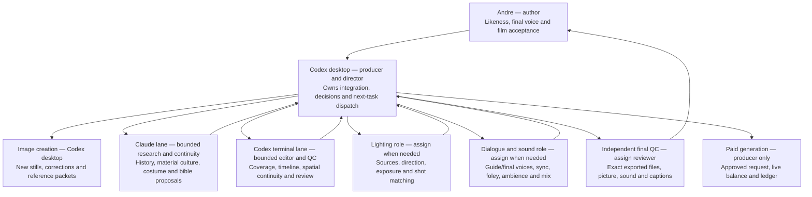
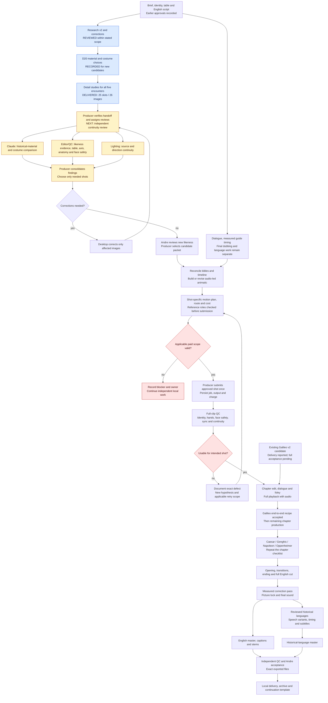
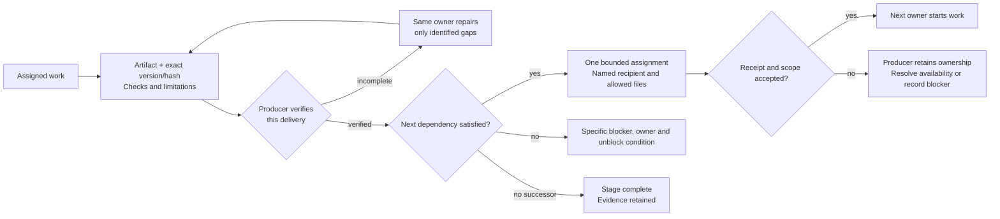

# Film workflow and responsibility map — v1

The Table Between Centuries · 10 October 2026 · Codex desktop producer.

Requested by Andre: map all currently known film tasks, their owners, dependencies and completion-to-next-task handoffs. This is the episode's operational map and decomposition of the existing production board; it does not create new production IDs, change approvals, or enable automatic execution. Workflow labels W01 onward are local section references, not new board or provider task IDs.

## Authority and how to read this map

- [Production board](../board.json) remains the source of production-task status; [task specification](../specs/production-tasks.md) remains the execution specification. The tables here are a dated view and finer planning breakdown, not a second live board. Refresh affected rows when delivering work; do not copy this whole file into messages.
- [Approvals](../../00_brief/approvals.json) and [decision records](../../00_brief/decisions/) control gates. Delivered, reviewed, integrated and artistically accepted remain distinct.
- **RECORDED COMPLETE** means the board records earlier completion in its original scope; it does not approve new D20 variants. **DELIVERED** means files exist; acceptance can still be pending. **REVIEWED** means the named review scope was performed. **READY** means a local input exists; it does not mean a lane was dispatched or is running. **WAITING** identifies a dependency or decision. **UNVERIFIED** means a reported delivery has not been rechecked in this mapping task.
- Role assignment is not live session status. Claude and the terminal Codex are intended bounded executors under the existing protocol; their readiness/receipt must be checked before a new dispatch. The desktop producer owns unassigned ready work until a recipient accepts it.
- Existing local Parley protocol uses messages, reports and file reservations, not remote forge issues. No remote, issue service, new hooks, scheduler or paid job was set up by this map.

## 1. Organigram — who is accountable

Roles may be performed by the same available executor on separate bounded tasks. A creator's self-check does not replace an independent final check. No additional agent is launched merely by appearing in this organigram.

## 2. Production flow — the creative chain

Parallel arrows are independent inputs, not a command to start every role. Lighting may be included in one bounded continuity review if a separate specialist would add no value. Existing Galileo media can be reviewed now; it does not wait for new paid generation. The image-review route does not require the old unconfirmed paid still test. Only affected shots pause for missing evidence.

## 3. Completion-to-next-task contract

A finished delivery is not operationally closed with an unowned next step. The producer records one of: **accepted next assignment**, **specific blocker with accountable owner**, or **no successor / stage complete**. A message sent but not accepted remains with the producer. This is an operational rule, not a tested automatic protection.

Each handoff must identify: scope and parent production task; input paths/versions; output paths/hashes; checks actually done; remaining defects; next task and named owner; readiness condition; allowed files; authority and spending limits. A retry reuses the same communication identity for the same dispatch, and a changed task/version gets a new one. Duplicate completion notices must not create duplicate assignments or generation requests. A completion signal never grants paid scope or artistic acceptance.

Hooks can notify the coordinator of an event. They do not prove success, approve work, or guarantee this desktop conversation will wake. Any future automatic dispatcher needs a separate implementation and tested evidence for duplicate events, stale versions, unavailable lanes, restart recovery, failed delivery checks and paid-action gates. No automatic dispatcher is claimed installed here.

## 4. Immediate queue — no lost next step

| Priority | Work | Accountable owner / intended executor | Readiness and stop condition |
|---|---|---|---|
| 1 | Package and dispatch independent review of the delivered image catalog | Desktop producer / Claude for materials, terminal Codex for visual/edit continuity | Inputs exist. Dispatch and acknowledgement are not performed by this diagram. Until confirmed, producer retains this ready task. No media generation or paid action. |
| 2 | Resolve only evidence-backed defects, select principal angle and minimal inserts | Desktop producer | Depends on review findings. Preserve originals and D09; right-shoulder studies are not current-cut selections. |
| 3 | Review Galileo v2 exact candidate with audio and reconcile timeline/bibles | Desktop producer / editor-QC | Existing reported delivery, separate from the new-image branch. Locate exact handoff/version before playback; no re-render by default. |
| 4 | Collect Andre's likeness judgment on selected new frames | Andre, arranged by producer | Review a small selected set, not 26 unprioritized approvals. Earlier pilot approval is not inherited. |
| 5 | Prepare the next minimal shot packet, measured timing and cost scope | Desktop producer | Can prepare locally once inputs are stable; submission remains gated. |

The current **explicit blocker to automatic continuation is that no automatic dispatcher is implemented**. This does not block the producer from dispatching authorized local work during an active turn. This document does not claim either lane is currently running.

## 5. Existing production board — all 21 tasks

Snapshot from `board.json` at creation; not a reinterpretation of acceptance. In particular, T03's earlier bible lock is not a lock of the new D20 variants, and T09's recorded completion covers the adopted guide/speech strategy while T07's final voice approval remains blocked. These scopes need reconciliation before any automatic dependency evaluation.

| ID | Existing task | Role | Board status | Board dependencies |
|---|---|---|---|---|
| T01 | Freeze the brief and spending boundaries | producer | completed | None |
| T02 | Receive references and the failed scene | continuity | completed | None |
| T03 | Lock the character and table bibles | continuity | completed | T02 |
| T04 | Create and verify the new Andre Element | producer | completed | T01, T03 |
| T05 | Fact-check and approve the English script | historian | completed | None |
| T06 | Resolve historical-language targets and reviewers | dialogue-sound | blocked | T05 |
| T07 | Approve voice samples and dry dialogue | dialogue-sound | blocked | T01, T05 |
| T08 | Approve a restrained four-shot identity pilot | continuity | completed | T03, T04 |
| T09 | Prove the speech route in both edition strategies | dialogue-sound | completed | T07, T08 |
| T10 | Reforecast costs and freeze the production envelope | producer | in_progress | T08, T09 |
| T11 | Approve the storyboard and audio-first animatic | storyboard | blocked | T05, T07, T10 |
| T12 | Approve era and eye keyframes | storyboard | in_progress | T03, T08, T11 |
| T13 | Produce Galileo as the first complete chapter | producer | in_progress | T09, T10, T12 |
| T14 | Produce Caesar coverage | producer | blocked | T13 |
| T15 | Produce Genghis Khan coverage | producer | blocked | T13 |
| T16 | Produce Napoleon coverage | producer | blocked | T13 |
| T17 | Produce Oppenheimer coverage | producer | blocked | T13 |
| T18 | Produce opening/ending and lock the English picture | editor | blocked | T13, T14, T15, T16, T17 |
| T19 | Spend the correction reserve on measured gaps | producer | blocked | T18 |
| T20 | Assemble and verify the historical-language edition | dialogue-sound | blocked | T06, T07, T19 |
| T21 | Finish, deliver, and independently verify both masters | qc | blocked | T19, T20 |

## 6. Detailed work packages — known tasks and successors

These W labels decompose the production tasks above. They do not replace board statuses or silently authorize new work. READY rows still need a bounded accepted assignment. Where work already exists, inspect and reuse it before generating or requesting more.

| Label / parent | Task and concrete output | Owner role | Current evidence / dependency → next step |
|---|---|---|---|
| W01 / T01 | Confirm brief, runtime, editions and boundaries | producer | Earlier freeze recorded; future changes need a scoped decision → chapter briefs |
| W02 / T01 | Maintain single resume surface and decision references | producer | STATE updated for delivered images → subsequent agents read current handoff |
| W03 / T01/T03 | Reconcile stale board blockers, bible variants and approval scopes | producer | READY: known mismatches, including T09/T07 and old keyframes → reliable dispatch conditions |
| W04 / T02 | Inventory real photos, synthetic variants, source rights and failed clips | continuity | Earlier inventory recorded; unresolved failed-clip evidence stays explicit → identity packet |
| W05 / T02/T03 | Keep dark wardrobe retired without deleting originals | continuity | Earlier logical retirement delivered → grey/white references only |
| W06 / T03 | Lock current Andre grooming, posture, wardrobe and table anchors | continuity + producer | Prior decisions exist; new shot geometry needs comparison → selected reference packet |
| W07 / T04 | Check existing Element resources and route compatibility | producer | Existing Element recorded; no automatic recreation → only compatible shot requests |
| W08 / T05 | Maintain English script, line IDs and factual anchors | historian + director | Earlier script approval recorded → any changed line requires proportionate review |
| W09 / T05/T11 | Fill difficult line, trigger word, prior emotion, reaction and consequence per encounter | director + editor | Coverage proposals exist; exact performance/timing not locked → chapter animatic |
| W10 / T05/T12 | Adopt historical research and resolve H01–H06 | historian + producer | REVIEWED: v2 adopted, uncertainty preserved → D20 candidate design |
| W11 / T03/T12 | Record floor, room, coat, hair, shoe and accessory choices | director | REVIEWED: D20 for new still candidates → new-bible reconciliation |
| W12 / T03/T12 | Review and integrate four revised bibles and continuity matrix | producer + continuity | Reported lane deliveries; full integration/acceptance not established by image review → current bible per chapter |
| W13 / T12 | Create five detail studies for each historical figure | desktop storyboard | DELIVERED: 25 slots, 26 candidates → independent still review |
| W14 / T12 | Review historical material, costume and uncertainty against images | historian / Claude intended | READY: catalog plus v2/D20 → findings only, no substitute generation |
| W15 / T12 | Review likeness evidence, proportions, expression and grooming | continuity / terminal Codex intended | READY: current still catalog → shortlist and Andre likeness gate |
| W16 / T12 | Review table, chairs, eye line, camera axis and physical placement | continuity + editor | READY: exact cross-angle geometry not proven → principal-angle selection |
| W17 / T12 | Review hands, fingers, footwear contact and rear-head facial safety | continuity + QC | Producer static check delivered; independent check READY → correction list |
| W18 / T12 | Review motivated light source, direction, shadows and era plausibility | lighting | Initial choices exist; final matching WAITING on selected shots → lighting sheet |
| W19 / T12 | Apply bounded image corrections and re-review only changed outputs | desktop storyboard | Six superseded variants preserved; further corrections conditional on findings → refreshed packet |
| W20 / T12 | Approve Andre likeness on selected new stills | Andre | WAITING: final new-image likeness approval → approved identity basis for animation |
| W21 / T11/T12 | Choose only required coverage and map images to actual shot slots | director + editor | READY after visual findings; 25 studies are not 25 mandatory cuts → animatic/shot packet |
| W22 / T12 | Review existing eyes-only references and needed reaction states | continuity | Existing references remain candidates in current recipe → selected safe eye shot if needed |
| W23 / T11 | Resolve timeline/bible timing differences without imposing global eye duration | producer + editor | READY: Galileo two-second choice is local → agreed shot timing |
| W24 / T07/T11 | Measure guide dialogue and pauses; build local scratch/animatic | dialogue-sound + editor | Reuse existing tracks; final voice not required for every local preparation step → audio-led pacing test |
| W25 / T07 | Choose Andre recording/dubbing route and short voice samples | dialogue-sound + Andre | Guide accepted only provisionally; final voice by ear WAITING → dry final lines |
| W26 / T07 | Prepare sparse historical-character voices and dry line tracks | dialogue-sound | Approved text and applicable audio scope required → measured tracks |
| W27 / T07/T09 | Measure final dialogue duration and reconcile dubbing with visible speech | dialogue-sound + editor | WAITING on recordings → tested sync or deliberate offscreen/L-cut route |
| W28 / T06 | Confirm historical-language targets, feasible route and qualified reviewers | dialogue-sound | Board blocked; never silently substitute a language → reviewed translations |
| W29 / T06 | Translate, back-translate and review pronunciation/meaning | qualified language reviewers | WAITING on target selection; can proceed independently of English picture where appropriate → historical dialogue |
| W30 / T09 | Test visible speech, mouth motion and likeness on intended route | continuity + dialogue-sound | Prior pilot route exists; changed image/angle can require bounded new proof → shot recipe |
| W31 / T08 | Check existing pilot evidence against new camera/costume references | producer + continuity | Earlier approval is scoped; do not repeat pilot without a specific gap → accepted operating envelope |
| W32 / T10 | Evaluate operator access and visual-review capability separately | producer | Future operator choice not settled by model name; roles remain producer-controlled → bounded production assignment |
| W33 / T10 | Refresh balance/capabilities and forecast accepted seconds, chapter caps and reserve | producer | Only before applicable paid work; historical snapshots not live → written shot/batch envelope |
| W34 / T11 | Build/review English audio-led animatic and approval package | storyboard + editor | Waiting on selected coverage and measured guide timing; not blocked by all final dubbing work → storyboard gate |
| W35 / T12/T13 | Build reference packet with roles and tested first/last versus multi-reference route | producer | Waiting on selection; no assumption that second reference is an OUT frame → exact request |
| W36 / T13–T17 | Define safe motion, camera limits, face exclusions and reaction causality | director + continuity | Per selected shot; still safety alone insufficient → generation preflight |
| W37 / T13–T17 | Verify approved request, schema, output settings and spending limits | producer | Gate before each paid submission; unresolved scope blocks only affected paid action → submit once |
| W38 / T13–T17 | Submit approved shot and persist returned job/charge immediately | producer | WAITING on preflight; one producer only → resume existing job |
| W39 / T13–T17 | Resume job, recover/download output, preserve originals and provenance | producer | No blind resubmission or automatic paid retries → full-clip QC |
| W40 / T13–T17 | Inspect every frame for historic faces, identity, anatomy and contact | QC | Per actual output, including reflections and intermediate frames → accept/reject evidence |
| W41 / T13–T17 | Inspect sync, reaction timing, sound and technical decode | editor + QC | Per actual output; contact sheets do not replace playback → usable-take decision |
| W42 / T13–T17 | Register take disposition and reconcile actual charges | producer | Evidence-based only; no successful-job-to-acceptance shortcut → chapter assembly |
| W43 / T13 | Locate and play exact Galileo v2 with full audio | editor + producer | Existing candidate reported delivered; full playback/acceptance WAITING → first complete recipe |
| W44 / T13 | Compare Galileo timeline with bible and replace only verified gaps | editor + producer | Do not rerender by default or require unused detail images → reviewed chapter |
| W45 / T13–T17 | Assemble and review each complete chapter | editor + QC | Galileo first; other generation gated on accepted recipe → full film |
| W46 / T14–T17 | Transfer recipe to Caesar, Genghis, Napoleon and Oppenheimer | producer | Board blocked on Galileo; research/still preparation already advanced → four reviewed chapters |
| W47 / T18 | Prepare and produce opening and ending under approved script | director + producer | Existing six slot plans; unapproved future ending ideas excluded → full cut |
| W48 / T18 | Normalize accepted sources and edit table transitions | editor | Only accepted/explicitly candidate inputs with labels → rough cut |
| W49 / T18 | Review complete English rough cut for story, pacing and continuity | director + QC | WAITING on usable chapter coverage → prioritized gap list |
| W50 / T18/T19 | Create foley, room tone, ambience and optional music under applicable scope | dialogue-sound | Cue specification delivered; actual media not produced by that document → layered sound edit |
| W51 / T18/T19 | Sync contact sounds and preserve meaningful silence | dialogue-sound + editor | Actual frame contact and selected materials, including rug versus wood → mix |
| W52 / T19 | Rank corrections and approve only measured replacement hypotheses | producer + QC | Likeness/facial safety/sync/story before polish → bounded correction request |
| W53 / T19 | Reinspect replacements and reconcile reserve/ledger | producer + QC | No automatic reruns; keep originals → stable final picture |
| W54 / T18/T19 | Conform final dialogue, color and shot-to-shot light; lock picture | editor + lighting | After resolved gaps; final voice timing must fit or sync must be revised → master mix |
| W55 / T21 | Mix dialogue/foley/ambience/music and measure loudness/true peak | dialogue-sound | Targets are not measurements → technical QC |
| W56 / T20 | Assemble historical-language edition with reviewed audio and speech variants | dialogue-sound + editor | WAITING on languages and suitable picture; do not stretch faces to fit → historical cut |
| W57 / T20/T21 | Create and review subtitles/captions against actual audio in both editions | dialogue-sound + language reviewers | Meaning, speaker, timing and spelling → delivery captions |
| W58 / T21 | Export exact English and historical masters and stems | editor | Chosen delivery target in task spec; source resolution not assumed → independent final QC |
| W59 / T21 | Decode and inspect stream metadata, joins, frames, captions and full audio playback | independent QC | Both exact exported files, not only timeline/source clips → evidence report |
| W60 / T21 | Obtain final likeness, performance, voice and story acceptance | Andre | Separate human acceptance gates → final delivery |
| W61 / T21 | Package local masters, captions, stems, sources, rights notes and ledger | producer | Preserve working originals and provenance → archive |
| W62 / T21/series | Archive episode and start clean continuation planning when requested | producer | No inherited approvals/budget/jobs; reusable method only → next episode draft |
| W63 / coordination | Accept next owner or retain a named blocker on every delivery | producer | Operational rule recorded here; not automated → no orphaned ready task |
| W64 / coordination | Review documentation consolidation and remove active duplication by reference | producer / Claude delivery | Reported consolidation pending integration review → one source per rule |
| W65 / coordination | Audit unused skills/plugins with project/global separation | producer | Inventory exists; no blanket removal authorized → bounded cleanup decision |
| W66 / coordination | Integrate one delivery at a time; verify hashes and concurrent changes | producer | Local files can be reviewed without commits; Git integration needs its own scope → verified base |
| W67 / coordination | Record checkpoints, validation and next dependency without repeated histories | producer | Group checks after management changes; communicate meaningful changes → next assignment |
| W68 / coordination | Design/test optional automatic dispatcher only under separate implementation scope | producer | Not installed; hooks alone are insufficient → tested event/owner/gate handling |

## 7. All 25 detail-study slots — actual delivered candidates

All remain candidates, not approved production takes. The extra Galileo hand-release frame is listed separately. Read [the catalog](../../05_storyboard/keyframes/detail-studies-v1/manifest.json) for exact hashes and [visual review](../../05_storyboard/keyframes/detail-studies-v1/review.md) for known limits. Left-shoulder views are principal candidates; right-shoulder views are axis alternatives outside the current D09 cut selection.

| Encounter | Hands | Feet/floor | Back/hair | Left shoulder | Right shoulder |
|---|---|---|---|---|---|
| Caesar | [Delivered · v1](../../05_storyboard/keyframes/detail-studies-v1/caesar-hands-v1.png) | [Delivered · v2](../../05_storyboard/keyframes/detail-studies-v1/caesar-feet-v2.png) | [Delivered · v1](../../05_storyboard/keyframes/detail-studies-v1/caesar-back-v1.png) | [Delivered · v2](../../05_storyboard/keyframes/detail-studies-v1/caesar-shoulder-left-v2.png) | [Delivered · v2](../../05_storyboard/keyframes/detail-studies-v1/caesar-shoulder-right-v2.png) |
| Genghis | [Delivered · v1](../../05_storyboard/keyframes/detail-studies-v1/genghis-hands-v1.png) | [Delivered · v1](../../05_storyboard/keyframes/detail-studies-v1/genghis-feet-v1.png) | [Delivered · v1](../../05_storyboard/keyframes/detail-studies-v1/genghis-back-v1.png) | [Delivered · v1](../../05_storyboard/keyframes/detail-studies-v1/genghis-shoulder-left-v1.png) | [Delivered · v1](../../05_storyboard/keyframes/detail-studies-v1/genghis-shoulder-right-v1.png) |
| Galileo | [Delivered · v1](../../05_storyboard/keyframes/detail-studies-v1/galileo-hands-v1.png) | [Delivered · v1](../../05_storyboard/keyframes/detail-studies-v1/galileo-feet-v1.png) | [Delivered · v1](../../05_storyboard/keyframes/detail-studies-v1/galileo-back-v1.png) | [Delivered · v1](../../05_storyboard/keyframes/detail-studies-v1/galileo-shoulder-left-v1.png) | [Delivered · v1](../../05_storyboard/keyframes/detail-studies-v1/galileo-shoulder-right-v1.png) |
| Napoleon | [Delivered · v3](../../05_storyboard/keyframes/detail-studies-v1/napoleon-hands-v3.png) | [Delivered · v1](../../05_storyboard/keyframes/detail-studies-v1/napoleon-feet-v1.png) | [Delivered · v1](../../05_storyboard/keyframes/detail-studies-v1/napoleon-back-v1.png) | [Delivered · v1](../../05_storyboard/keyframes/detail-studies-v1/napoleon-shoulder-left-v1.png) | [Delivered · v1](../../05_storyboard/keyframes/detail-studies-v1/napoleon-shoulder-right-v1.png) |
| Oppenheimer | [Delivered · v1](../../05_storyboard/keyframes/detail-studies-v1/oppenheimer-hands-v1.png) | [Delivered · v1](../../05_storyboard/keyframes/detail-studies-v1/oppenheimer-feet-v1.png) | [Delivered · v1](../../05_storyboard/keyframes/detail-studies-v1/oppenheimer-back-v1.png) | [Delivered · v1](../../05_storyboard/keyframes/detail-studies-v1/oppenheimer-shoulder-left-v1.png) | [Delivered · v2](../../05_storyboard/keyframes/detail-studies-v1/oppenheimer-shoulder-right-v2.png) |

Extra: [Galileo hand release](../../05_storyboard/keyframes/detail-studies-v1/galileo-hands-out-v1.png), delivered candidate; no animation test. Existing ten IN/OUT images and ten posters remain separate candidate deliveries, not replacements for these detail studies or proof of new likeness acceptance.

## 8. Repeat this chapter checklist for each of the five encounters

Each row is a required planning/review action per encounter, even where its result is “not needed.” Inserts/eyes are optional coverage, not mandatory generated shots. Production slot IDs remain in [the manifest](../../manifest.json); its 41-slot plan is not blanket authorization or a guarantee that all original timings survive the new edit.

| Chapter action | Caesar | Genghis | Galileo | Napoleon | Oppenheimer | Owner / completion evidence |
|---|---|---|---|---|---|---|
| Research and requested correction disposition | Reviewed scope | Reviewed scope | Reviewed scope | Reviewed scope | Reviewed scope | Historian/producer; v2 + correction review |
| Art choices for new detail studies | D20 | D20 | D20 | D20 | D20 | Producer; documented fiction/uncertainty |
| Five detail-study candidates | Delivered | Delivered | Delivered + hand OUT | Delivered | Delivered | Desktop; catalog/hash |
| Independent image/material/light continuity review | Ready | Ready | Ready | Ready | Ready | Bounded reviewer; findings by image/version |
| Current bible reconciled with selected new shots | Pending | Pending | Pending | Pending | Pending | Continuity + producer; no stale wardrobe/equipment |
| Exact difficult line, reaction and consequence against performance | Pending lock | Pending lock | Candidate timing exists | Pending lock | Pending authorial interpretation | Director/editor; measured line and visible cause |
| Andre likeness on selected new candidates | Pending | Pending | Pending | Pending | Pending | Andre; scoped judgment |
| Safe motion/axis/reference packet | Pending | Pending | Pending for new images | Pending | Pending | Producer; exact inputs and route |
| Final voice / dubbing and sync | Pending | Pending | Guide candidate only | Pending | Pending | Dialogue-sound; voice-by-ear and sync review |
| Paid request scope and live preflight | Not released here | Not released here | Existing batch is not new-frame release | Not released here | Not released here | Producer; approved exact request |
| Actual clip production and complete QC | Not accepted complete | Not accepted complete | v2 candidate reported | Not accepted complete | Pilot is not chapter | Producer + QC; actual outputs/charges |
| Foley/ambience contacts and chapter mix | Specs only | Specs only | Candidate audio still needs playback | Specs only | Specs only | Sound/editor; frame-aligned contacts |
| Complete chapter playback and acceptance | Pending | Pending | Pending | Pending | Pending | QC + producer + applicable Andre gate |
| Historical-language target/audio/captions | Pending | Pending | Pending | Pending | English-context requirements still reviewed | Language role; explicit target and acceptance |

## 9. Reuse and sources

Reusable principle: verified delivery → explicit next owner → accepted assignment → next work, or named blocker/stage completion. Keep episode-specific people, statuses, inputs, budgets and approvals out of inherited continuation templates.

Sources read for this map: `tasks/board.json`, `tasks/specs/production-tasks.md`, `manifest.json`, `00_brief/approvals.json`, `memory/STATE.md`, `tasks/specs/scene-detail-assets-v1.md`, `agents/handoffs/2026-10-10-producer-detail-studies-v1.json`, `08_edit/reviews/detail-planning-v2/`, `docs/2026-10-09-direcao-encontros-fala-dificil.md`; workspace `docs/PARLEY_PROTOCOL.md`, `docs/REPEATABLE_WORKFLOW.md`, `docs/TOKEN_EFFICIENCY.md`, `agents/registry.json`, and `series/andre-time-travel/FRAMEWORK.md`.

Conflicts retained for reconciliation: original framework's fixed eye duration versus later scene-specific direction; old board dependencies and partially scoped speech approval; unintegrated bible/timeline proposals; older take status requiring full playback. The map does not silently choose new dialogue, eye durations or final approvals.
