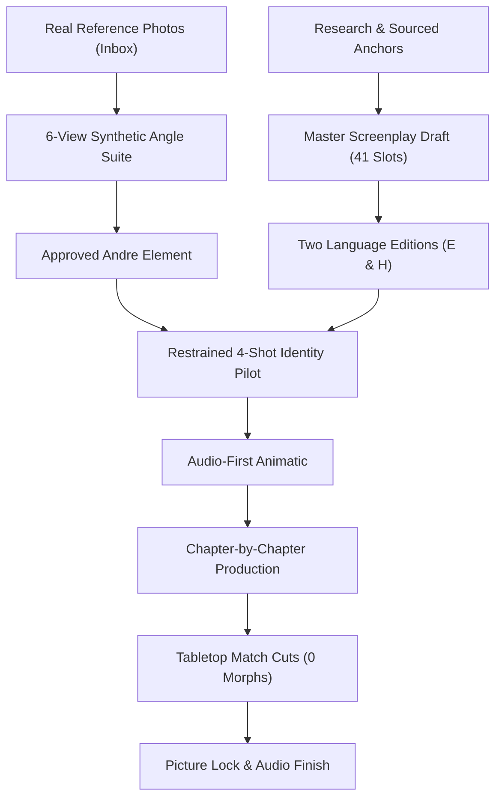

# The Table Between Centuries — Master Production Bible & Visual Reference Suite

> [!IMPORTANT]
> **Production Status:** Pre-production foundation locked. Character geometry, wardrobe sheets, historical setting plates, eye-reaction anchors, master screenplay, and translated historical dialogue bibles are compiled. All historical figures strictly adhere to the **zero full-face contract** (macro eye-crops and below-neck framing only).

---

## 1. Project Overview & Workflow Architecture

*The Table Between Centuries* is a 4-minute cinematic short film starring **Andre Athar**. Andre sits across a timeless, unpainted oak table from five historical figures—**Julius Caesar, Genghis Khan, Galileo Galilei, Napoleon Bonaparte, and J. Robert Oppenheimer**—asking what came after their triumphs and reckoning with how history remembers them.



### The Non-Negotiable Rules of Production

1. **Andre's Likeness Consistency:** Andre's face, grooming, hair, and wardrobe (charcoal shirt, navy unstructured blazer) remain identical across all eras.
2. **Zero Full Faces of Historical Figures:** In zero frames do we reveal the full face, nose, mouth, or chin of any historical figure. They are characterized exclusively through **macro eye-crops** (brow to lower eyelid) and **below-neck wardrobe and hands**.
3. **The Plain Wooden Table Motif:** A single rustic oak table serves as the spatial and temporal bridge. Era transitions happen via camera match cuts on the table grain and Andre's hand—never by morphing facial geometries or sci-fi portal effects.
4. **Two Master Editions:**
   - **Edition E (All-English):** English dialogue for all characters.
   - **Edition H (Reviewed Historical Languages):** Classical Latin (Caesar), Middle Mongol (Genghis), 17th-century Tuscan (Galileo), Corsican / Period French (Napoleon), English (Oppenheimer).
5. **Decoupled Lip-Sync Strategy:** Visual takes where mouth movement is not visible (reactions, over-the-shoulder, table inserts) are 100% shared across both editions. Only mouth-visible speaking takes require language synchronization.

---

## 2. Andre Athar — Character & Camera Envelope

Andre's physical consistency is anchored by high-resolution multi-angle references preserving his natural features, grooming, and clothing drape.

````carousel

<!-- slide -->

<!-- slide -->

<!-- slide -->

````

### Camera & Lighting Specifications
- **Screen Axis:** Seated screen-left, looking camera-right (15° to 35° angle).
- **Lighting:** Soft 45° directional key light with natural rim separation; gentle ambient warmth adapting to each historical setting without shifting natural skin tones.
- **Allowed Movement:** Controlled, restrained head nods, steady eye contact, natural breathing; zero fast head rotations or occluding hand gestures.

---

## 3. Wardrobe & Costume Reference Suite

Every garment has been researched and rendered with tactile fabric realism.

````carousel

<!-- slide -->

<!-- slide -->

<!-- slide -->

<!-- slide -->

<!-- slide -->

````

| Character | Era | Garment Details | Key Accessories |
|---|---|---|---|
| **Andre Athar** | Contemporary | Dark charcoal garment-dyed cotton-linen shirt, unbuttoned collar; deep navy unstructured lightweight wool blazer. | Silver wedding band on left ring finger; no modern watch. |
| **Julius Caesar** | 44 BCE Rome | Off-white fine wool tunica with broad Tyrian purple vertical stripe (*latus clavus*); cream wool *toga praetexta*. | Round antique gold fibula clasp; Roman iron/gold signet ring. |
| **Genghis Khan** | 1227 Steppe | Heavy dark brown patterned silk deel lined with wolf fur; boiled hardened leather lamellar chest armor with brass studs. | Wide leather belt with brass plaques; flint pouch; scarred hands. |
| **Galileo Galilei** | 1634 Arcetri | Heavy dark charcoal wool doublet with small fabric buttons; wide white linen falling collar; dark academic gown. | White linen cuffs with iron-gall ink smudges; drafting compass; quill. |
| **Napoleon Bonaparte** | 1816 St. Helena | Forest-green wool Chasseurs-à-Cheval tailcoat with red piping; brass eagle buttons; white piqué waistcoat. | Red Légion d'Honneur ribbon and Grand Cross star; leather *Code Civil*. |
| **J. Robert Oppenheimer** | 1945 Trinity | Baggy charcoal gray herringbone tweed wool jacket; soft relaxed collar white cotton shirt; narrow dark knit tie. | Silver pocket watch chain; pack of Lucky Strike cigarettes; Army notebook. |

---

## 4. Scene Environment Plates & Table Anchors

The plain wooden table anchors each era's spatial setting.

````carousel

<!-- slide -->

<!-- slide -->

<!-- slide -->

<!-- slide -->

<!-- slide -->

````

---

## 5. Historical Eyes References (Strictly Zero Full-Face)

The historical figures communicate emotion exclusively through the eyes. Macro framing (brow to lower eyelid) captures intense shifts in power, pride, doubt, and dread.

````carousel

<!-- slide -->

<!-- slide -->

<!-- slide -->

<!-- slide -->

<!-- slide -->

<!-- slide -->

<!-- slide -->

<!-- slide -->

<!-- slide -->

````

---

## 6. Master Screenplay & Dialogue (Edition E & Edition H)

### Act I: Opening (12 seconds)
- **Scene:** Contemporary minimalist room, soft morning diffused light.
- **Visual:** Andre's hand rests on the wood grain of the table. He speaks directly to the camera-right space.
- **Line IN-L01 (Andre):**
  > *"I wanted to ask history a question. Not what happened. What it felt like to hear what came next."*
- **Transition:** Hand rests on the table. Sound falls away. Sharp match cut to Rome.

---

### Act II: The Five Encounters

#### Chapter C — Julius Caesar (42 seconds | Rome, early 44 BCE)
- **C-L01 — Caesar (O.S.):**
  - **English:** *"Does my name survive?"*
  - **Classical Latin:** *"Superestne nomen meum?"*
- **C-L02 — Andre:**
  - **English:** *"Your name survives. So do the reforms and the victories people study. But they also study how much power one man can hold—and what happens to a republic around him."*
  - **Classical Latin:** *"Nomen tuum superest. Atque instituta et victoriae quae homines discunt. Sed etiam discunt quantum imperium unus homo capere possit—et quid rei publicae circum eum accidat."*
- **Eye Cue A (`C-03`):** Focused command and imperial pride.
- **C-L03 — Caesar (O.S.):**
  - **English:** *"Then they remember a tyrant?"*
  - **Classical Latin:** *"Ergo tyrannum me meminerunt?"*
- **C-L04 — Andre:**
  - **English:** *"They argue about you. A brilliant commander. An ambitious ruler. I came to ask what victory leaves behind."*
  - **Classical Latin:** *"De te contendunt. Imperatorem egregium. Dominum cupidum. Veni rogatum quid victoria post se relinquat."*
- **Eye Cue B (`C-05`):** The calculation softens into mortal uncertainty.

---

#### Chapter K — Genghis Khan (42 seconds | Western Xia Tent, 1227)
- **K-L01 — Khan (O.S.):**
  - **English:** *"Will my sons keep what I have made?"*
  - **Middle Mongol:** *"Minu kö'ütd minu bayiguγsan ulus-i sakiqu buyu?"*
- **K-L02 — Andre:**
  - **English:** *"They will enlarge it. Routes across Eurasia will carry merchants, ideas, and knowledge. But conquest also leaves ruined cities and families who never return."*
  - **Middle Mongol:** *"Tede yeke-ber öskekü boluyu. Qorin ayan-u mör-iyer qudaldučin, sedkil, erdem tegegegdeküy-e. Ketürkei dayin ber ebderkei balγad, büri-dü ülü harilqu ger-ün ulus-i üldegemüy."*
- **Eye Cue A (`K-03`):** Controlled imperial pride.
- **K-L03 — Khan (O.S.):**
  - **English:** *"And what will they call me?"*
  - **Middle Mongol:** *"Namayi keni kemen neregüy-e?"*
- **K-L04 — Andre:**
  - **English:** *"A founder. A conqueror. They will argue about what your empire joined—and what it destroyed. None of those words can make the dead speak."*
  - **Middle Mongol:** *"Bayiγuluγsan kü'ün. Ezilegči. Ulus čin-u yaghu-yi qolboba, yaghu-yi ebdeb kemen margalduqu bui. Tegebed ber terigün üges ükegsed-i ügülügüljü ülü čidayu."*
- **Eye Cue B (`K-05`):** Hardened pupils soften; guarded stillness at "families who never return."

---

#### Chapter G — Galileo Galilei (42 seconds | Arcetri Study, 1634)
- **G-L01 — Galileo (O.S.):**
  - **English:** *"Am I finally believed?"*
  - **17th-Century Tuscan:** *"Son io finalmente creduto?"*
- **G-L02 — Andre:**
  - **English:** *"People learn from you. They also turn you into a simple story: one scientist against a whole world. The truth is harder than that."*
  - **17th-Century Tuscan:** *"Gli uomini imparano da voi. Ma vi riducono anche a una favola semplice: un solo filosofo contro l'intero mondo. La verità è assai più aspra."*
- **Eye Cue A (`G-03`):** Exhausted attention through weariness.
- **G-L03 — Galileo (O.S.):**
  - **English:** *"And what survives of the question?"*
  - **17th-Century Tuscan:** *"E che cosa sopravvive della questione?"*
- **G-L04 — Andre:**
  - **English:** *"Your observations. And the warning in your trial. Silencing a person does not settle a question."*
  - **17th-Century Tuscan:** *"Le vostre osservazioni. E l'ammonimento del vostro processo. Far tacere un uomo non risolve la controversia."*
- **Eye Cue B (`G-05`):** Quiet renewed resolve and moral defiance.

---

#### Chapter N — Napoleon Bonaparte (42 seconds | Saint Helena, 1816)
- **N-L01 — Napoleon (O.S.):**
  - **English:** *"Does France keep my laws?"*
  - **Corsican (*Corsu*):** *"A Francia tene e mo leghje?"*
  - **French:** *"La France garde-t-elle mes lois ?"*
- **N-L02 — Andre:**
  - **English:** *"Your civil code outlives your throne. Other countries borrow from it. But a law can promise equality and still deny it to someone."*
  - **Corsican:** *"U vostru codice civile supravive à u vostru tronu. D'altri paesi piglianu da ellu. Ma una leghje pò prumette l'ugualità è quantunque ricusalla à qualchissia."*
  - **French:** *"Votre code civil survit à votre trône. D'autres nations s'en inspirent. Mais une loi peut promettre l'égalité tout en la refusant à quelqu'un."*
- **Eye Cue A (`N-03`):** Pride at "outlives your throne."
- **N-L03 — Napoleon (O.S.):**
  - **English:** *"And do they call me great?"*
  - **Corsican:** *"È mi chjamanu grande?"*
  - **French:** *"Et m'appelle-t-on grand ?"*
- **N-L04 — Andre:**
  - **English:** *"Some do. Others ask about the wars and the power you kept for yourself. When they say greatness, they still argue about the price."*
  - **Corsican:** *"Qualchì unu sì. D'altri dumandanu di e guerre è di u putere ch'è vo avete tenutu per voi stessi. Quand'elli dicenu grandezza, disputanu sempre di u prezzu."*
  - **French:** *"Certains le font. D'autres interrogent les guerres et le pouvoir que vous avez gardé pour vous-même. Lorsqu'ils parlent de grandeur, ils débattent encore du prix."*
- **Eye Cue B (`N-05`):** Pride bruised by the human cost; gaze lowers slowly.

---

#### Chapter O — J. Robert Oppenheimer (42 seconds | Trinity Shack, July 15, 1945)
- **O-L01 — Oppenheimer (O.S.):**
  - **English:** *"Does the test work?"*
- **O-L02 — Andre:**
  - **English:** *"It works. Weeks later, atomic bombs strike Hiroshima and Nagasaki. People will argue about ending the war, about those who died, and about the fear that follows."*
- **Eye Cue A (`O-03`):** Anticipation drains from the eyes; hollow shock.
- **O-L03 — Oppenheimer (O.S.):**
  - **English:** *"Can you tell me whether it was right?"*
- **O-L04 — Andre:**
  - **English:** *"I can tell you what came next. That is not the same as answering the question."*
- **Eye Cue B (`O-05`):** Chilling stillness and moral paralysis.

---

### Act III: Ending (18 seconds)
- **Scene:** Back at the empty table in the contemporary room.
- **Visual:** Andre looks out across the empty chair. The morning light has advanced slightly.
- **Line OUT-L01 (Andre):**
  > *"I went looking for answers in the past. I came back with a question for us. What will they have to tell us about the things we are doing now?"*
- **Ending Beat:** Hold on the wooden table grain. Gentle fade to black.

---

## 7. Project File Sitemap

All project files have been systematically organized within the local workspace:

- **Manifest:** [manifest.json](file:///mnt/data/Projects_SSD/Movies_Projects/projects/andre-time-travel/manifest.json)
- **Task Board:** [board.json](file:///mnt/data/Projects_SSD/Movies_Projects/projects/andre-time-travel/tasks/board.json)
- **Approvals Ledger:** [approvals.json](file:///mnt/data/Projects_SSD/Movies_Projects/projects/andre-time-travel/00_brief/approvals.json)
- **Production Plan:** [production-plan.md](file:///mnt/data/Projects_SSD/Movies_Projects/projects/andre-time-travel/docs/production-plan.md)
- **Andre Character Bible:** [character-andre.md](file:///mnt/data/Projects_SSD/Movies_Projects/projects/andre-time-travel/03_bibles/character-andre.md)
- **Table Continuity Bible:** [table-and-continuity.md](file:///mnt/data/Projects_SSD/Movies_Projects/projects/andre-time-travel/03_bibles/table-and-continuity.md)
- **Scene Bibles:**
  - [caesar.md](file:///mnt/data/Projects_SSD/Movies_Projects/projects/andre-time-travel/03_bibles/scene-bibles/caesar.md)
  - [genghis.md](file:///mnt/data/Projects_SSD/Movies_Projects/projects/andre-time-travel/03_bibles/scene-bibles/genghis.md)
  - [galileo.md](file:///mnt/data/Projects_SSD/Movies_Projects/projects/andre-time-travel/03_bibles/scene-bibles/galileo.md)
  - [napoleon.md](file:///mnt/data/Projects_SSD/Movies_Projects/projects/andre-time-travel/03_bibles/scene-bibles/napoleon.md)
  - [oppenheimer.md](file:///mnt/data/Projects_SSD/Movies_Projects/projects/andre-time-travel/03_bibles/scene-bibles/oppenheimer.md)
- **Translated Historical Dialogue:**
  - [latin-caesar.md](file:///mnt/data/Projects_SSD/Movies_Projects/projects/andre-time-travel/01_script/translations/latin-caesar.md)
  - [mongol-genghis.md](file:///mnt/data/Projects_SSD/Movies_Projects/projects/andre-time-travel/01_script/translations/mongol-genghis.md)
  - [italian-galileo.md](file:///mnt/data/Projects_SSD/Movies_Projects/projects/andre-time-travel/01_script/translations/italian-galileo.md)
  - [corsican-napoleon.md](file:///mnt/data/Projects_SSD/Movies_Projects/projects/andre-time-travel/01_script/translations/corsican-napoleon.md)
